<div align="center">

<picture>
  <source media="(prefers-color-scheme: dark)" srcset="docs/images/logo/logo-dark.svg">
  
</picture>

**A classic space game, easier to play today: pick up a controller, read every spoken line, and see clearly on any screen.**<br>
A free mod for Freelancer (2003) and Freelancer: HD Edition. Full controller support, subtitles for every line of dialogue, a clear modern HUD and tidier movies. One installer, nothing else to set up.

<p>
<a href="../../releases/download/v0.4.0/FLvibed-0.4.0-Setup.exe"></a>
</p>

<sub>One-click installer and uninstaller · <a href="../../releases/download/v0.4.0/FLvibed-0.4.0.zip">the zip, to install by hand</a> · <a href="../../releases/tag/v0.4.0">Release notes</a> · <a href="CHANGELOG.md">Changelog</a></sub>

<p>


</p>

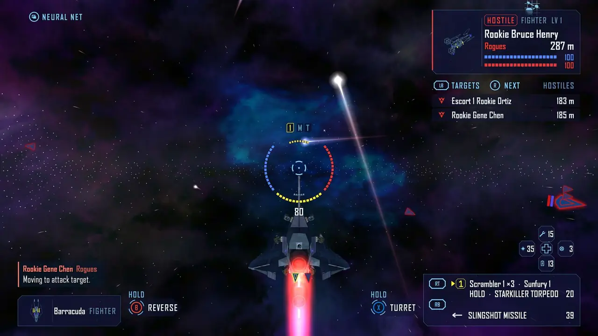

<sub>HUD 2, FLvibed's own flight HUD, in a fight on the controller (every picture here is a real in-game capture)</sub>

</div>

> Made with AI: written by Claude, by Anthropic, under the author's direction and tested in game. Free, with no warranty.

## 🆕 New in 0.4.0

**A new look for the whole game, and a simpler way to set it up.** The full list: [CHANGELOG.md](CHANGELOG.md).

- **One clear look everywhere:** the star map, dialogs, main menu, loading screen and every shop now match the flight HUD. Prefer the original look? It is one setting away.
- **Shops that fit:** panels size themselves to what they show, text stays inside its box, and a refused purchase tells you why in plain view.
- **See what you are fighting:** a small card when you pick a target, then its name, distance and health on the ship itself, and a cue when your guns are in range.
- **A calmer screen:** the flight HUD covers less, shows your boost and cruise on the reticle, and comes in Small, Normal and Large for your screen.
- **Buy a ship on the controller:** the whole purchase works without a mouse.
- **Simple options:** five tabs with the settings most players need, and a short welcome the first time you start. Everything else waits under Show all settings.
- **More controllers:** PlayStation and Switch pads work directly, and pads can now rumble with what happens on screen.

## 🌟 See everything in the living spec

<div align="center">

<a href="https://claude.ai/artifact/4v4dXbB5GTVt1URowFtSvN">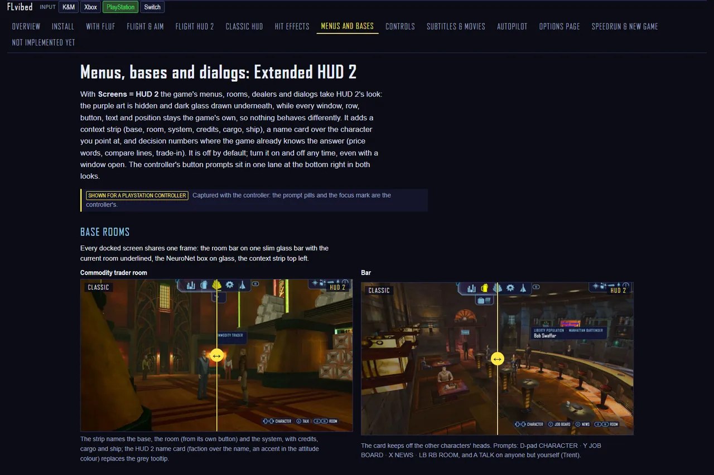</a>

<a href="https://claude.ai/artifact/4v4dXbB5GTVt1URowFtSvN"></a>

</div>

The best tour of FLvibed is one interactive page: real in-game pictures with **drag sliders** (before and after), a
switch that shows every prompt for your own controller, an options page to try, the full button layout, how to install,
and an honest list of what is not done yet.

📁 There is an offline copy too: [docs/spec/index.html](docs/spec/index.html).

## ✨ What you get

- 🎮 **Controller play everywhere.** Fly, fight, dock, trade and use every menu with a controller: button prompts on
  each screen, shown for Xbox, PlayStation, Nintendo or Steam pads, an on-screen keyboard, three flight layouts
  (FREELANCER, ACE, ASSISTED). Touch the pad and the controller interface appears in one frame; move the mouse and the
  game's own interface is back. Keyboard and mouse keep working exactly as before.
- 🎯 **Gimbal aim.** The right stick steers through the game's own mouse flight; the reticle locks onto your target's
  lead by itself (or follows the stick, with aim assists). The ship is never steered for you.
- 🛰️ **HUD 2.** FLvibed's own HUD, in Freelancer's art: shield, hull and power on a ring around the reticle, only the
  actions that apply now - and the same look over the menus, bases, dealers and dialogs (every window, row and button
  stays the game's own). On by default with the pad and with keyboard and mouse, and contextual by default since 0.2.5:
  it fades out in calm flight and wakes per action. The classic HUD stays one setting
  away, with button icons on it and a short list of what you can do now.
- 💬 **Dialogue subtitles.** Story scenes, mission comms, bars and the Neural Net, with the speaker's name in their
  colour and their portrait, timed on the speaker's words. Story lines stay on screen until they are spoken; radio
  chatter and lines from NPCs without a portrait go to the game's chat window.
- 🎬 **Better movies.** The startup movies fit the screen with their aspect kept, and the intros (HD, original 2003,
  full Bonus DVD cut) are subtitled. Every dialogue line is reviewed by ear, and the 19 room-scene mixes are subtitled
  since 0.2.0.
- ⚙️ **An options page in the game.** Every setting on a **FLVIBED** page inside the game's own Options screen: five
  tabs, changes apply at once, works with mouse, keyboard and pad.
- 🏁 **New Game modes.** Normal, Assisted (the autopilot ready from the first mission) or Speedrun mode (an in-game
  timer, a split per story checkpoint, LiveSplit fed automatically).
- 🤖 **The Advanced Autopilot** 🧪 *(work in progress).* Hand it the ship and it plays: missions, jobs, travel,
  docking and fights, by one set of rules - [all about it below](#-the-advanced-autopilot).
- 💥 **Hit effects and rumble.** Screen-edge cues in your own shield's and hull's look when you are hit, reticle pulses
  for the autopilot and consumables, and pad vibration on hits. All on by default, and each can be turned off.
- 🌐 **Multiplayer** 🧪 *(since 0.2.0).* HUD 2, targeting, subtitles and the autopilot on a server, as far as the server
  allows ([Compatibility](#-compatibility)).
- 🖥️ **Any screen.** Any resolution or shape, with HUD sizes for handhelds and big screens alike.
- 🪶 **Nothing else to install.** No launcher and no extra runtimes. Each feature can be switched off on its own, and no
  game file is changed.

## 📸 A look around

<table>
<tr>
<td width="50%">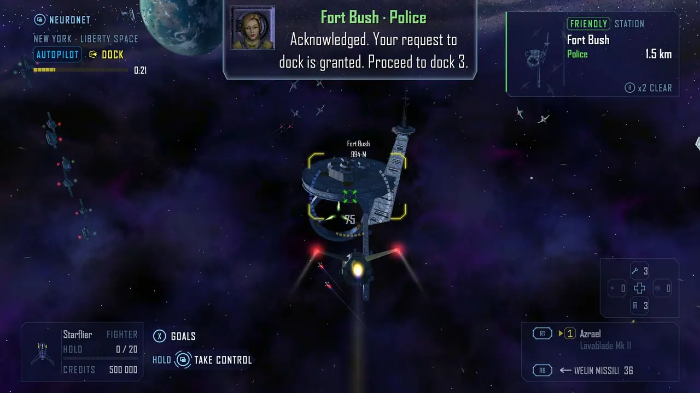<br><sub>💬 <b>Subtitles:</b> a comm with its portrait in the top panel, radio chatter in the chat window</sub></td>
<td width="50%">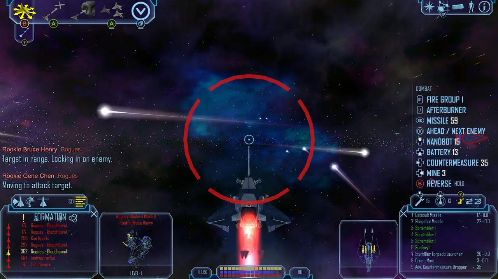<br><sub>🎮 <b>Classic HUD on the pad:</b> glyph badges on the game's own buttons, the actions that apply now</sub></td>
</tr>
<tr>
<td width="50%">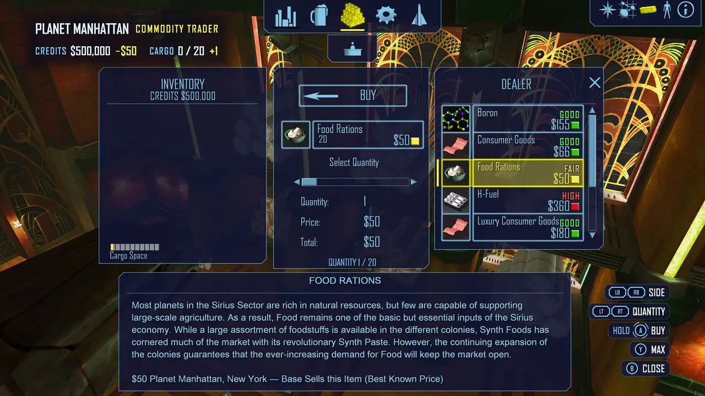<br><sub>🖼️ <b>HUD 2 in bases:</b> a dealer in HUD 2's look, driven by the pad</sub></td>
<td width="50%">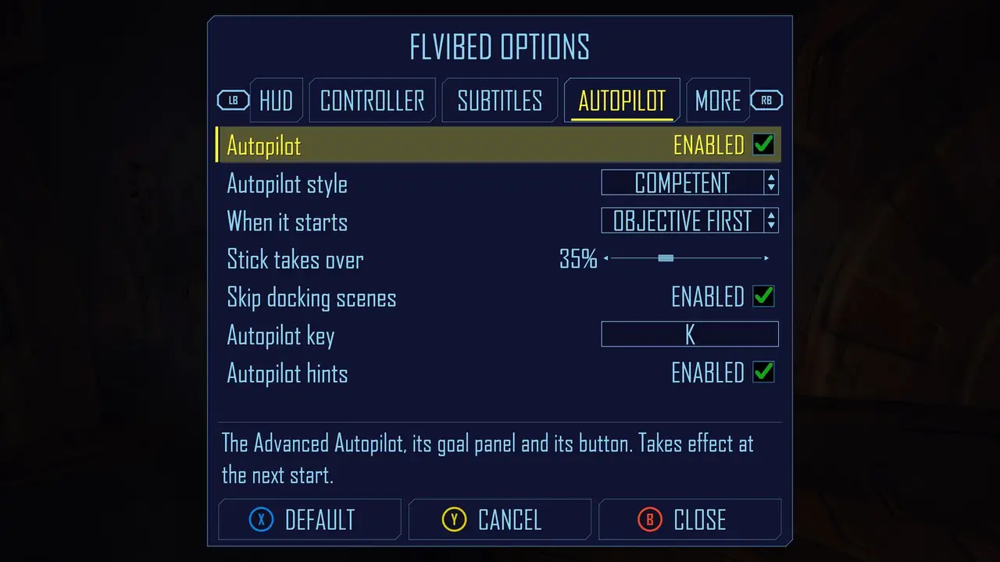<br><sub>⚙️ <b>The options page:</b> inside the game's own Options screen</sub></td>
</tr>
</table>

<div align="center">
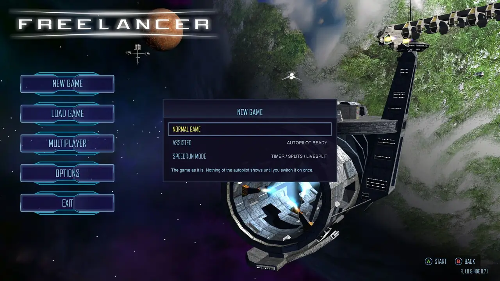<br>
<sub>🏁 <b>New Game:</b> normal, assisted or speedrun mode</sub>
</div>

## 🤖 The Advanced Autopilot

Hand FLvibed the ship and it plays Freelancer for you. One start for every device: **hold View** on the pad, or press
**K** (or the maneuver bar's autopilot button) on the keyboard. It picks what makes sense - the current mission or job
objective, else your nav map waypoints (across systems), else your target. Touch a stick, or press it again, and the
ship is yours.

<table>
<tr>
<td width="50%">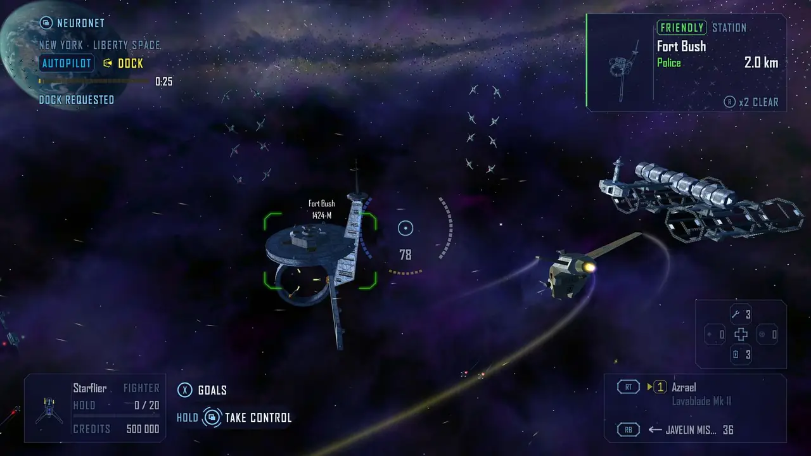<br><sub>🛰️ <b>Flying:</b> what it does on the HUD, one button to take control</sub></td>
<td width="50%">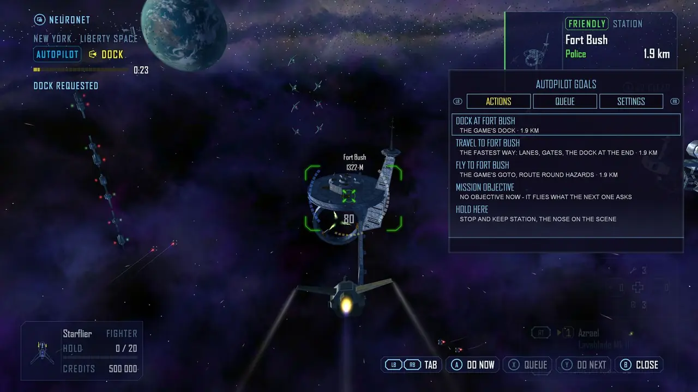<br><sub>🧭 <b>The goal panel:</b> tell it what to do (X on the pad while it flies, Shift+K on the keyboard)</sub></td>
</tr>
<tr>
<td width="50%">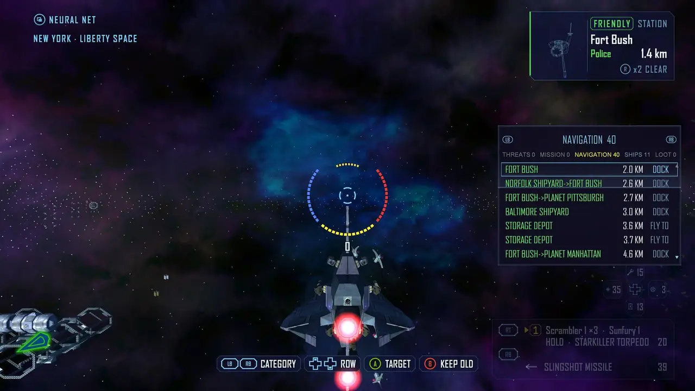<br><sub>🎯 <b>The target picker</b> (LB): threats, mission, navigation, ships, loot</sub></td>
<td width="50%">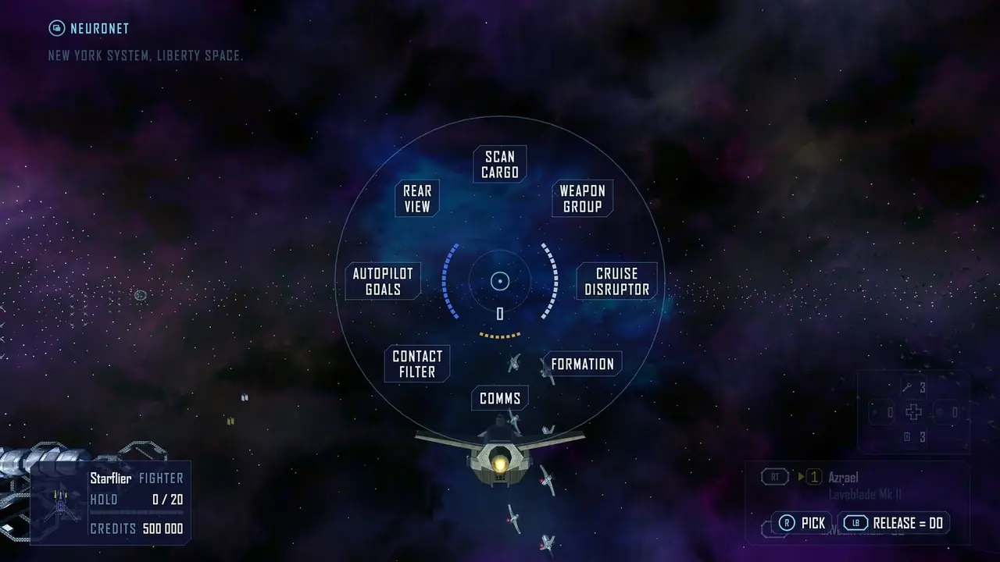<br><sub>🎡 <b>The action wheel</b> (LB held): quick actions on the right stick</sub></td>
</tr>
</table>

**What it does today**

- 📜 **Story missions** - it reads the mission's own objectives and trigger conditions live (no per-mission scripts)
  and has flown every story mission from the first to the last.
- 💼 **Jobs** from the job board, by the same objective reading (kill ships and assassinate jobs
  are proven so far).
- 🛣️ **Travel** by trade lanes, gates and jump holes, across systems along your waypoints, routing round minefields
  and damage zones.
- 🛬 **Docking** with the fast dock and the queue shortcut, skipping the docking scene.
- ⚔️ **Fights** - targets by threat and odds, evades, spends missiles by economy; escorts, follows, or holds station
  with its nose on the scene.
- 🛡️ **Reflexes under every goal** - countermeasures against homing missiles, nanobots and shield batteries by need,
  loot worth the detour.
- 💬 **It explains itself** - the HUD names what it does and why; a cyan ring marks it taking over, an amber one handing
  back.
- 🎛️ **Presets** - COMPETENT (the default: it knows only what you have seen), SPEEDRUN (it knows everything the game
  data tells) and NO CONSUMABLES; every behaviour also has its own setting.
- 🧑‍🚀 **It plays as you** - it starts from your live state (ship, reputation, the choices you made), never from a fixed
  script.

**How good is it?** Its yardstick is the fastest recorded human speedruns. Across all 14 story legs it is about 20 %
slower than the record pace today (12,034 s against 10,047 s), and within 6 seconds of it in mission 12. It still
fails some runs: docking at moving ships, the mines in mission 11 (about half its runs), deaths in missions 12 and 13.

**Where it's headed**

- 🏆 **Speedrun-grade play** - every story leg at or under the fastest human run, by one general set of rules.
- 🎬 **Zero input** - a New Game played through to the end of the story, unattended.
- 📋 **A goal queue** - queue, reorder and "do next": multi-step trips and trade runs as your own plan.
- 🤝 **Playing alongside you** - you on the guns or picking targets while it flies (the ASSISTED layout); how the two
  of you share control is still being designed.
- 🎚️ **Behaviour you mix and match** - focus (story, trading, jobs, exploring), engagement (fight, defend, avoid),
  routes (official lanes only, or shortcuts) and knowledge (what you have seen, or everything).
- 🖱️ **Everything on every device** - the target picker and the action wheel get keyboard-and-mouse versions.

## 🗺️ Where FLvibed is headed

| | Today | Headed for |
|---|---|---|
| 🎮 **Controller** | Every screen on the pad, three layouts, glyphs for four pad families; flight and combat proven on a real Elite pad | A bindings editor for your own layout, nav map objects as pad controls, every screen proven on real pads |
| 🛰️ **HUD 2** | FLvibed's own HUD, in flight and over menus and bases (the default) | Refined from real play; more layouts (Focus experimental, Speedrun and Guided planned) |
| 💬 **Subtitles** | Every spoken line, timed on the words, with names, colours and portraits | Every line reviewed by ear against the audio |
| 🤖 **Autopilot** | Plays missions, jobs, travel, docking and fights | Speedrun-grade, zero-input, alongside you (above) |
| 🖥️ **Display** | Borderless windowed and windowed at any size and DPI | Exclusive fullscreen verified too |
| 📦 **Install** | A one-click installer and uninstaller (or the zip by hand) | TBD |
| 🧩 **Compatibility** | HD Edition 0.7.1, the original 1.1, FLUF beside it | Newer HD Edition releases, more mods |

> [!IMPORTANT]
> 🧪 **0.4.0 is an early preview - expect rough edges and change.**
> - **Some features are incomplete:** the Advanced Autopilot is work in progress, a few screens and controls are not
>   built yet, and some are proven only by the test harness so far.
> - **Design choices are still subject to change:** button layouts, HUD 2's look, setting names
>   and defaults, and how the autopilot behaves may all change in later versions.
>
> What is missing right now: [Known limits](#-known-limits).

## 📋 Requirements

- 🪟 **Windows 10 or 11** (tested). **Windows 7 SP1, 8 and 8.1** since 0.2.0: every release is checked to use nothing
  newer than Windows 7, but a tester's Windows 7 needed VxKex to run 0.3.0 (0.1.0 did not load there). Since 0.3.5 FLvibed is built
  with a compiler that still targets Windows 7: expected to work without VxKex, not yet confirmed on a real Windows 7.
- 🚀 **Freelancer: HD Edition 0.7.1** - the base FLvibed is built and tested on. It brings everything else needed.
- 💿 Or **the original Freelancer 1.1 with a decrypted `Freelancer.exe`** (the CD's exe is SafeDisc-protected, and
  SafeDisc does not run on Windows 10 / 11). Verified in game through the first mission and a full regression pass.
- 🎮 **A controller** - or none: keyboard and mouse work too. Xbox pads are read through XInput. A PlayStation or Switch
  pad works by itself: FLvibed reads it natively through SDL3, the button prompts following the pad, and ignores Steam
  Input's or a mapper's output for it, so each press acts once. To hand the pad to them, turn off **Read PlayStation and
  Switch pads natively** in Options. A Steam Deck or Steam Controller stays on Steam Input, its native route. Other pads
  need an XInput layer. `pad_backend = 1` always uses SDL3.
- You supply your own copy of the game. FLvibed ships no game files and no audio.

## 🚀 Getting started

**1. Prepare the game**

- **HD Edition:** install Freelancer: HD Edition 0.7.1 with its installer.
- **Original game:** install Freelancer with its official installer (it installs the fonts and registry keys), apply
  the official 1.1 patch and put a decrypted 1.1 `Freelancer.exe` into `EXE\`.

**2. Install FLvibed** - one click

1. ⬇️ Download **[FLvibed-0.4.0-Setup.exe](../../releases/download/v0.4.0/FLvibed-0.4.0-Setup.exe)** and run it.
   Windows SmartScreen may warn, because the setup isn't code-signed: choose *More info > Run anyway*.
2. It finds your game (HD Edition's installer, the original game's, or the usual folders - else you pick the folder):
   choose **Install or update FLvibed**. No administrator rights are needed unless the game folder is protected.

The setup copies FLvibed's files into `EXE\`, adds the line `FLvibed.dll` to `EXE\dacom.ini` and keeps your settings
on an update. No game file is changed.

<details>
<summary>🔧 Install by hand instead (the zip)</summary>

1. Download **[FLvibed-0.4.0.zip](../../releases/download/v0.4.0/FLvibed-0.4.0.zip)** and unpack it.
2. Copy its `EXE` folder into your Freelancer folder (the one that holds `EXE\Freelancer.exe`) and let it merge:
   `FLvibed.dll`, `FLSubtitles\` and `FLvibed\` land in `EXE\`. An update this way keeps your settings.
3. Open `EXE\dacom.ini` in a text editor and add the line `FLvibed.dll` to the `[Libraries]` section, after the plugins
   already listed (on the original game after `.\flmaterials.dll`).

To remove it by hand: take the `FLvibed.dll` line out of `EXE\dacom.ini`, then delete `EXE\FLvibed.dll`, `FLvibed.ini`,
`FLController.ini`, `FLSubtitles.ini`, any `*.before-0.2.0` backups of them, the FLvibed logs and the folders
`EXE\FLSubtitles\` and `EXE\FLvibed\`.

</details>

**3. Play.** Start the game as usual and pick up the pad. Settings: **Options > FLVIBED** (also the pause menu's sixth
button). `EXE\FLvibed.ini` switches each part on or off (`subtitles = 1`, `controller = 1`).

**🗑️ Uninstall:** *Windows Settings > Apps > Installed apps > FLvibed*, or run the setup again and choose **Uninstall
FLvibed**. It takes FLvibed's line out of `dacom.ini` and deletes its files; you choose whether your FLvibed settings go
too. Your saves are never touched (the per-save game mode lives in `EXE\FLvibed\saves.ini`, not in the save).

## 🎮 Controls

The default **FREELANCER** layout in flight:

| Button | Tap | Hold |
|---|---|---|
| Right stick | steer | |
| Left stick | throttle / strafe | |
| RT | fire guns | |
| LT | afterburner | |
| RB | missile | torpedo |
| LB | target picker | action wheel |
| A | context: dock / lane / jump, tractor one item (the targeted loot, with no target the nearest), else go to | formation |
| B | free flight (drops cruise) | reverse |
| X | tractor everything in reach (the prompts name the item and its range) | turret view on / off: the reticle stays centred, the right stick turns the camera |
| Y | next weapon group | cruise (its state always under the reticle) |
| RS (click) | the nearest enemy, clicks within 3 seconds the next ones; with no enemy near, the nearest object inside the reticle ring (double click: clear) | rear view |
| LS (click) | engine kill | |
| D-pad | ⬆️ nanobots · ⬇️ shield battery · ⬅️ countermeasures · ➡️ mine | |
| View | NeuroNet / nav map | hold: Advanced Autopilot |
| Menu | pause | |

- 🕹️ **Menus and bases:** A accept, B back, LB / RB tabs, LT / RT pages, the D-pad moves the focus, the left stick the
  cursor, the right stick scrolls, View the NeuroNet hub, Menu pause.
- ⌨️ **Keyboard and mouse:** the game's own keys. **K** (or the maneuver bar's fifth button) starts the autopilot - it
  picks the current mission or job objective, else your nav map waypoints, else your target; **Shift+K** opens its goal
  panel.
- ✋ Any stick input past a threshold hands the ship back from the autopilot. Prompts for held buttons say **HOLD**
  beside a broken-ring outline on the glyph.

The ACE and ASSISTED layouts and the per-screen controls: [docs/UI_PLAN.md](docs/UI_PLAN.md); the research behind the
layouts: [modules/controller/docs/BINDINGS.md](modules/controller/docs/BINDINGS.md).

## ⚙️ Settings

Change settings in game on the **FLVIBED** page of the Options screen. They are stored in the game's `EXE\` folder
(`FLvibed.ini` `[Modules]`, `FLController.ini` `[Controller]` + `[Autopilot]`, `FLSubtitles.ini` `[Subtitles]`). The
ones most players touch:

| Setting | Default | What it does |
|---|---|---|
| `pad_preset` | 0 | flight layout: 0 Freelancer, 1 Ace (left stick steers, triggers throttle), 2 Assisted |
| `aim_mode` | 1 | 1 gimbal (reticle locks onto the target's lead), 0 the reticle follows the right stick |
| `hud_style` | 2 | 0 classic HUD and screens, 1 HUD 2 on the pad, 2 HUD 2 always (flight, menus and bases) |
| `hud_fade` | 1 | 0 full (HUD 2 always shown), 1 contextual (fades in calm flight, wakes per action) |
| `hud_prompts` | 1 | 1 context prompts show on change and fade, 0 always shown |
| `chat_size` | 0 | side chat text: 0 Normal, 1 Large (the 0.2.0 size) |
| `maneuver_watchdog` | 1 | restart a formation / goto / dock that stalls |
| `ui_style` | 1 | menus and rooms while HUD 2 is on: 1 HUD 2's look, 0 the game's look |
| `glyph_style` | 0 | button prompts: 0 automatic, 1 Xbox, 2 PlayStation, 3 Nintendo, 4 Steam |
| `input_mode` | 0 | 0 automatic (the last device used wins), 1 controller, 2 keyboard and mouse |
| `shield_cue` | 1 | hit effects at the screen edges (`reticle_cue`: the crosshair pulses, also on) |
| `borderless` | 1 | 0 off, 1 only where nothing else provides it (HD Edition does), 2 always |
| `rumble` | 60 | vibration strength in percent on hits, a failing shield and the game's waiting boxes (0 = off) |
| `confirm_button` | 0 | menus accept with 0 the bottom face button (A / cross), 1 the right one (Nintendo) |
| `mp_autopilot` | 1 | multiplayer, when the server says nothing: 0 no autopilot, 1 travel only, 2 everything |
| `enabled` (Subtitles) | 1 | subtitles on |
| `size` (Subtitles) | 1 | text size, 0 small to 4 huge |
| `speaker_names` | 0 | 0 the name on its own row, 1 inline, 2 off |
| `movie_fit` | 1 | movies keep their aspect, encoded black bars zoomed out |
| `movie_intro` | 0 | which intro plays: as installed, HD, original 2003, full Bonus DVD |

📖 Every key with type, range, default and help (generated from the code): [docs/SETTINGS.md](docs/SETTINGS.md).

**Modules:** each feature can be turned off in `EXE\FLvibed.ini` `[Modules]` (`0` off, `1` on). The FLVIBED page switches
all of them. A row you never set follows the module named beside it, so a new row changes nothing.

| Row | Module | Follows |
|---|---|---|
| `subtitles` | dialogue subtitles, chat, speakers | |
| `controller` | the pad, its screens, prompts, wheel and picker | |
| `hud` | HUD 2 and its look on the game's windows | `controller` |
| `autopilot` | the Advanced Autopilot, its goal panel and bar button | `controller` |
| `display` | borderless window, window fit, running out of focus | `controller` |
| `speedrun` | clock, splits, LiveSplit | `controller` |
| `npc` | the stall recorder | `controller` |
| `movies` | fitted movies, intro choice, skip | `subtitles` |

With `subtitles = 0` and `controller = 0` nothing starts, whatever the other rows say. `safe = 1` turns everything off, for
troubleshooting.

## 🧩 Compatibility

| With | State |
|---|---|
| ✅ **Freelancer: HD Edition 0.7.1** | The primary target: every feature is built and tested on it (4K borderless and 1600x1200 windowed among others). Its plugins (jflp, FLSharp 0.8, HudShift, flplusplus ...) run alongside; FLvibed's hooks chain behind theirs. The newer HDE after 0.7.1 is checked by reading its exe and patches only, not in game yet. |
| ✅ **The original Freelancer 1.1** (decrypted exe) | Runs the whole mod; verified in game through the first mission and in a regression pass (flight, both HUDs, a base and a dealer, comms with subtitles, the autopilot). Without HDE's plugins: no zone arrival lines in HUD 2 and no maneuver-bar shift. |
| 🧪 **FLUF** (The Starport's framework) | Tested with FLUF nightly-2026-10-16 on the original game: FLUF's windows stay on top, FLvibed's HUD fades under them, the pad drives them. That FLUF build has its own issues (details in [docs/MOD_COMPATIBILITY.md](docs/MOD_COMPATIBILITY.md)); other FLUF builds get co-residency only. FLUF does not load on HD Edition. |
| 🧪 **Borderless windowed** | HD Edition provides it and FLvibed stays out. On the original game FLvibed runs the game as a borderless window covering its monitor - sharp at high DPI scaling only with a DPI-aware exe. In any borderless window that covers its monitor the mouse stays in the game at the screen edges, as in fullscreen. |
| 🧪 **Multiplayer** (since 0.2.0) | Tested on a local HD Edition server (FLServer + FLHook): the pad, HUD 2, targeting, subtitles and the chat work, and so does the Advanced Autopilot - **as far as the server allows**: a server line `[flvibed autopilot=on]`, `=travel` (flying and docking, no shooting) or `=off` decides - server hosts can send it with the FLHook plugin in `server/flhook/` - else the setting `mp_autopilot` (default: travel only). Missions, splits and speedrun mode are single player. Not tested yet: internet servers, modded servers (Discovery ...), the original game as client. Details: [docs/MULTIPLAYER.md](docs/MULTIPLAYER.md). |
| ❔ **Exclusive fullscreen** | Not verified - use borderless or windowed. |
| ❔ **Other mods** (Discovery, Crossfire ...) | Not tested. Every game address FLvibed uses is verified by signature, so a spot another mod changed is refused (and logged) instead of crashing. |

## 🚧 Known limits

What FLvibed does not do yet, or does only in part. Anything here - and the design around it - may still change.

- 📦 **Unsigned setup:** Windows SmartScreen may warn before the setup runs (*More info > Run anyway*).
- 🎮 **Other pads:** no DirectInput support: a pad that is neither XInput, PlayStation nor Switch needs an XInput layer.
  PlayStation and Switch pads are read through SDL3, proven with SDL's virtual pads and played on a real DualSense Edge
  on a cable; not yet on a real Switch pad, over Bluetooth, or with Steam Input's mapping seen being dropped. What a
  mapper sends while the pad rests (Steam's gyro, macros) still reaches the game.
- 📳 **Rumble** and **ignoring the pad while the game is in the background** are verified by the test
  harness only so far, not yet on a real pad.
- 🤖 **The Advanced Autopilot is work in progress:** it still fails some runs, its goal queue (QUEUE / DO NEXT) is
  not built, and how it shares control with a player on the guns is not designed yet ([details](#-the-advanced-autopilot)).
- 🎮 **Real pads:** flight and combat are verified on a real Xbox Elite pad; the menus, bases, dealers and on-screen
  keyboard so far on a virtual pad only.
- 🎯 **HUD 2 and the game's target label:** when a target sits behind HUD 2's target card on screen, the game's own
  name and health label for it can draw over the card.
- 🖱️ **Pad-only pieces:** the target picker and the action wheel have no mouse version yet (keyboard and mouse target
  through the game's contact list).
- 🧱 **Not built yet:** a bindings editor (the three layouts apply; CUSTOM = FREELANCER), nav map objects as pad
  controls, the inventory's jettison hold and the equipment compare line.
- 🖥️ **Exclusive fullscreen** is not verified, nor the movie subtitle overlay in it. OBS Game Capture cannot see the
  movies or their subtitles (use Window or Display Capture).
- 💬 **Subtitle text:** the dialogue lines are reviewed line by line; the room scenes recorded as one track (the 19
  scene mixes) are still under review, so a few of their lines may differ slightly from what is spoken.
- 🧪 **Beside FLUF**, and **FLvibed's borderless window** by a player (Alt+Tab, Alt+Enter, the cursor at the screen
  edges): verified by the test harness only so far.

The full, current list is the [living spec](https://claude.ai/artifact/4v4dXbB5GTVt1URowFtSvN)'s "Not implemented
yet" section.

## 📚 More

- 🌟 [The living spec](https://claude.ai/artifact/4v4dXbB5GTVt1URowFtSvN) (offline copy: [docs/spec/](docs/spec/index.html))
- ⚙️ [All settings](docs/SETTINGS.md) · 🧩 [Mod compatibility](docs/MOD_COMPATIBILITY.md) ·
  🤖 [The autopilot](modules/autopilot/docs/AUTOPILOT.md) · 💬 [Subtitle display](modules/subtitles/docs/DISPLAY_PLAN.md) ·
  🎨 [UI decisions](docs/UI_PLAN.md), [HUD 2](modules/hud/docs/UI_HUD2.md)
- 🧠 [Verified game facts](docs/FREELANCER_RE.md) and the [game knowledge base](docs/kb/README.md)

## 🛠️ Building from source

Needs Visual Studio with the C++ desktop tools and the MSVC v143 14.44 toolset (an individual component; it installs beside
the default one). Newer toolsets no longer target Windows 7, so `build.cmd` pins 14.44 and refuses to build without it. It finds Visual Studio and builds
32-bit (x86), C++17, with the static C runtime. On a fresh clone run `tools\sdl3\fetch_sdl3.ps1` once first.

```bat
build.cmd release   :: build\release\FLvibed.dll - everything in one DLL (what players get)
build.cmd           :: dev build: build\dev\FLvibed.dll (hooks) + FLvibedLogic.dll (the logic, hot-reloadable)
build.cmd test      :: build\test\fltest.exe - host-free unit tests, built and run in seconds, no game needed
build.cmd sigtool   :: build\sigtool\sigtool.exe - the Freelancer.exe signature tool
build.cmd setup     :: build\setup\FLvibed-Setup.exe - the players' installer / uninstaller (after build.cmd release)
build.cmd flhook    :: flvibed_server.dll - the optional FLHook server plugin (server/flhook/README.md); not in the release
```

How it is put together, and how to add a module: [docs/ARCHITECTURE.md](docs/ARCHITECTURE.md). `tools/deploy.ps1` builds, installs into a test install and starts or hot-reloads the game. The development tools
(PowerShell, Python, Node) and the test rules: [tools/README.md](tools/README.md), [docs/TESTING.md](docs/TESTING.md).

<details>
<summary>🗂️ Project layout</summary>

| Path | What |
|---|---|
| `core/` | DLL entry and module switches, hooks (signature-verified game addresses in `core/flexe.h`), settings, logging, the shared game layer (`core/game/`: rooms, missions, space, routes, flight, drawing in the game's look) |
| `modules/` | One folder per module, each with its `src/` and, where it has them, `docs/`, `data/`, `tools/`: `autopilot`, `controller`, `display`, `hud`, `movies`, `npc`, `speedrun`, `subtitles` |
| `subtitles/review/` | The subtitle text's authoring: speech-to-text pipeline, word aligner, review tool and every review decision; it publishes the data into `modules/subtitles/data/` |
| `server/` | The FLHook plugin for multiplayer hosts |
| `docs/` | Design and reference: the UI, settings, compatibility, testing, verified game facts, speedrun splits, the spec (`docs/spec/`) |
| `docs/kb/` | The game knowledge base: topic pages, mission set pieces, lore |
| `docs/missions/` | Mission runbooks for the test harness |
| `docs/research/` | Outside research (other mods, speedruns, UI references), kept current |
| `research/` | Local evidence and reference material, git-ignored except the speedrun legs table |
| `tools/` | Build, deploy, evidence and game-data tools; the test harness in `tools/harness/`; the spec's source in `tools/uimock/` |
| `tests/` | Host-free unit tests of the pure core pieces (`build.cmd test`) |

</details>

## 📜 Credits and licences

**Freelancer** is © Microsoft. FLvibed uses game content under the Microsoft Game Content Usage Rules
(https://www.xbox.com/en-US/developers/rules). It is free and non-commercial, and it is not endorsed by or affiliated
with Microsoft. Players supply their own game; this repository and FLvibed ship no game files and no audio. The
pictures in this README and in `docs/spec/` are captures of the game with FLvibed running.

**Subtitle data** (`modules/subtitles/data/`): the spoken lines and speaker names only, in separate data files. It uses the work
of **FLSubs** by Lorash, **Freelancer Subtitles** by L@Zar0 and the Russian edition's editor (GPL-3.0), and the
**wedge009.net** mission transcripts (CC BY-SA 4.0) and the other transcript sites they cite. The subtitle data is
therefore licensed **GPL-3.0** ([LICENSES/GPL-3.0.txt](LICENSES/GPL-3.0.txt)), with thanks to everyone who contributed.

**Code:** FLvibed's source code is licensed **GPL-3.0** ([LICENSES/GPL-3.0.txt](LICENSES/GPL-3.0.txt)), like the
subtitle data. It links the third-party libraries named below under their own licences.

**SDL** (Simple DirectMedia Layer, https://libsdl.org/) 3.4.18 is linked into FLvibed.dll for the optional SDL3
controller backend (`pad_backend = 1`). SDL is © 1997-2026 Sam Lantinga and is used under the **zlib licence**
([LICENSES/SDL3-zlib.txt](LICENSES/SDL3-zlib.txt)); it is built unmodified from the official release source.

🙏 **Thanks** to Jason Hood (adoxa) for his Freelancer plugins and their sources, the Freelancer: HD Edition team, The
Starport (FLUF, FLSubs) and the Freelancer community's documentation and transcripts.
