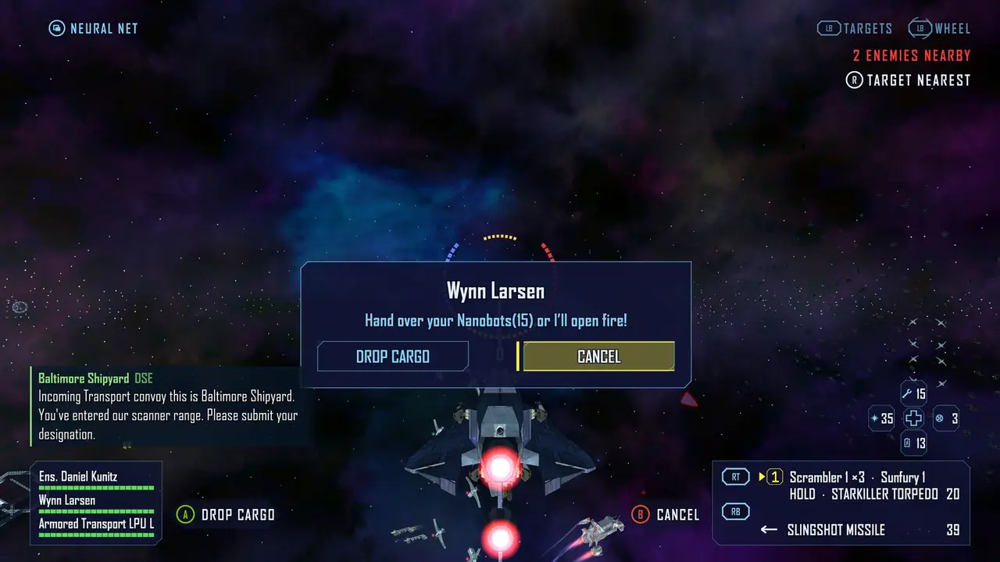
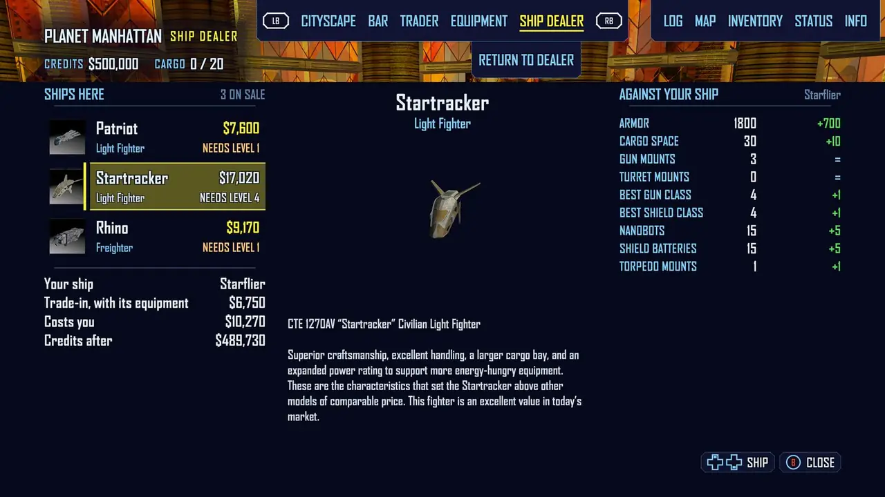
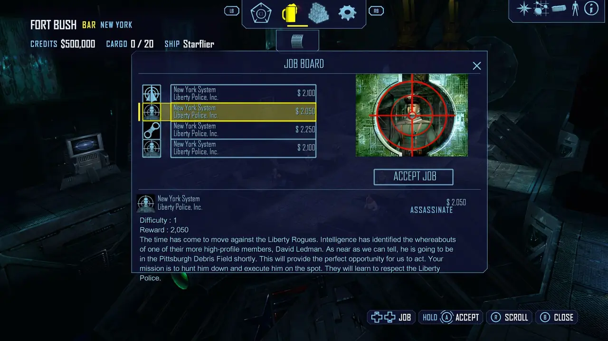
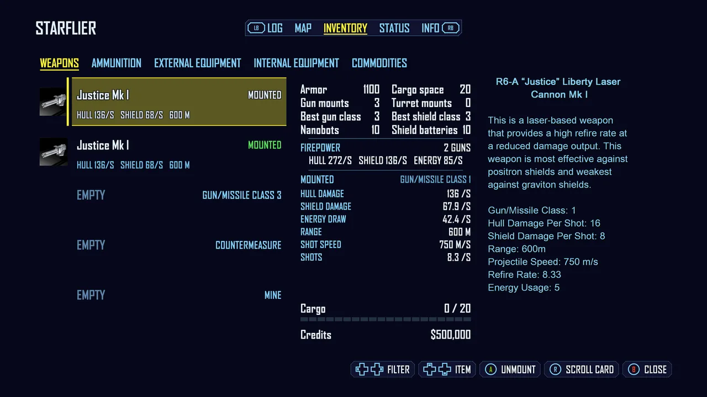

<div align="center">

<picture>
  <source media="(prefers-color-scheme: dark)" srcset="docs/images/logo/logo-dark.svg">
  
</picture>

**A classic space game, easier to play today: pick up a controller, read every spoken line, and see clearly on any screen.**<br>
A free mod for Freelancer (2003) and Freelancer: HD Edition. Full controller support, subtitles for every line of dialogue, a clear modern HUD and tidier movies. One installer, nothing else to set up.

<p>
<a href="../../releases/download/v0.4.6/FLvibed-0.4.6-Setup.exe"></a>
</p>

<sub>One-click installer and uninstaller · <a href="../../releases/download/v0.4.6/FLvibed-0.4.6.zip">the zip, to install by hand</a> · <a href="../../releases/tag/v0.4.6">Release notes</a> · <a href="CHANGELOG.md">Changelog</a></sub>

<p>


</p>


<sub>HUD 2, FLvibed's own flight HUD, in a fight on the controller (every picture here is a real in-game capture)</sub>

</div>

> Made with AI: written by Claude, by Anthropic, under the author's direction and tested in game. Free, with no warranty.

## 🆕 New in 0.4.6

This release works through the players' reports: the bugs first, then the smaller requests.

<div align="center">

</div>

- **Two critical fixes:** mounting and unmounting weapons works only while docked, as in the game, and the Intro option is gone (on a Steam Deck it could leave the game on a black screen).
- **Cargo demands in HUD 2's look:** a pirate's or the police's demand is a clear dialog, A drops and B cancels, and the flight HUD stays up under it.
- **A tidier flight HUD:** a small card shows a mission payout or the loot you just took in, then fades; nothing covers the weapons display any more.
- **Smoother Neural Net pages:** clean switches between tabs, every item's icon, a Total Time that counts, and map names and hover hints in HUD 2's look.
- **Subtitles in HUD 2's font** everywhere, by default (the game's font is one setting away).
- **Controller:** hold the right stick's click for the rear view, X tractors loot in every layout, and Autopilot Goals is on the action wheel.

Everything else, with the reports' issue numbers: [CHANGELOG.md](CHANGELOG.md).

## ✨ What you get

- 🎮 **Controller play everywhere.** Fly, fight, dock, trade and use every menu with a pad. Button prompts on every screen, for Xbox, PlayStation, Nintendo and Steam pads.
- 🖱️ **Keyboard and mouse as before.** Touch the pad and the controller interface appears at once; move the mouse and the game's own interface is back.
- 🛰️ **HUD 2, FLvibed's own HUD.** Shield, hull and power on a ring around the reticle, and only the actions that matter right now. It fades in calm flight and carries the same look into the menus and bases.
- 💬 **Dialogue subtitles.** Story scenes, mission comms, bars and the Neural Net, with the speaker's name, colour and portrait, timed on the spoken words.
- 🤖 **The Advanced Autopilot** *(work in progress)*. Hand it the ship and it plays: missions, jobs, travel, docking and fights ([more below](#-the-advanced-autopilot)).
- ⚙️ **Everything adjustable in game.** A FLVIBED page in the game's Options screen; changes apply at once, and each feature can be switched off.
- 🪶 **Nothing else to install.** No launcher, no extra runtimes, and no game file is changed.

<details>
<summary>And a few more things</summary>

- 🎯 **Gimbal aim:** the right stick steers through the game's own mouse flight, and the reticle locks onto your target's lead by itself. The ship is never steered for you.
- 🎮 **Three flight layouts** (FREELANCER, ACE, ASSISTED) and an on-screen keyboard.
- 🛰️ **The classic HUD stays one setting away,** with button icons on it and a short list of what you can do now.
- 🎬 **Better movies:** the startup movies fit the screen with their shape kept, and the intro movies are subtitled.
- 🏁 **New Game modes:** Normal, Assisted (the autopilot ready from the first mission) or Speedrun mode (an in-game timer, a split per story checkpoint, LiveSplit fed automatically).
- 💥 **Hit effects and rumble:** screen-edge cues in your own shield's look when you are hit, and pad vibration. Each can be turned off.
- 🌐 **Multiplayer** *(tested on a local server):* HUD 2, targeting, subtitles and the autopilot on a server, as far as the server allows ([Compatibility](#-compatibility)).
- 🖥️ **Any screen:** any resolution or shape, with HUD sizes for handhelds and big screens alike.

</details>

## 🌟 See everything in the Feature Tour

<div align="center">

<a href="https://claude.ai/artifact/4v4dXbB5GTVt1URowFtSvN"></a>

<a href="https://claude.ai/artifact/4v4dXbB5GTVt1URowFtSvN"></a>

</div>

One interactive page with everything: real in-game pictures with drag sliders (before and after), the prompts for your own
controller, an options page to try, the full button layout, and an honest list of what is not done yet.
There is an offline copy too: [docs/spec/index.html](docs/spec/index.html).

## 📸 A look around

<table>
<tr>
<td width="50%"><br><sub>💬 <b>Subtitles:</b> a comm with its portrait in the top panel, radio chatter in the chat window</sub></td>
<td width="50%"><br><sub>🎮 <b>Classic HUD on the pad:</b> glyph badges on the game's own buttons, the actions that apply now</sub></td>
</tr>
<tr>
<td width="50%"><br><sub>🚀 <b>The ship dealer:</b> the ship in 3D, trade-in and its numbers against yours</sub></td>
<td width="50%"><br><sub>🍸 <b>The job board:</b> a panel in the bar, every job's type and reward</sub></td>
</tr>
<tr>
<td width="50%"><br><sub>🧠 <b>The Neural Net, full screen:</b> the inventory with empty hardpoints and the ship's numbers</sub></td>
<td width="50%"><br><sub>⚙️ <b>The options page:</b> inside the game's own Options screen</sub></td>
</tr>
<tr>
<td colspan="2" align="center"><br><sub>🏁 <b>New Game:</b> normal, assisted or speedrun mode</sub></td>
</tr>
</table>

## 🤖 The Advanced Autopilot

Hand FLvibed the ship and it plays Freelancer for you. **Hold View** on the pad, or press **K** on the keyboard. It
picks what makes sense: the current mission or job, else your waypoints, else your target.

Touch a stick, or press it again, and the ship is yours.

<table>
<tr>
<td width="50%"><br><sub>🛰️ <b>Flying:</b> what it does on the HUD, one button to take control</sub></td>
<td width="50%"><br><sub>🧭 <b>The goal panel:</b> tell it what to do (AUTOPILOT GOALS on the action wheel, Shift+K on the keyboard)</sub></td>
</tr>
<tr>
<td width="50%"><br><sub>🎯 <b>The target picker</b> (LB): threats, mission, navigation, ships, loot</sub></td>
<td width="50%"><br><sub>🎡 <b>The action wheel</b> (LB held): quick actions on the right stick</sub></td>
</tr>
</table>

It has flown every story mission from the first to the last, reading each mission's own objectives as it goes, with no
per-mission scripts. It is still a work in progress and fails some runs.

<details>
<summary>What it does today</summary>

- 📜 **Story missions:** it reads the mission's objectives and triggers live.
- 💼 **Jobs** from the job board, read the same way (kill ships and assassinate jobs are proven so far).
- 🛣️ **Travel** by trade lanes, gates and jump holes, across systems along your waypoints, round minefields and damage zones.
- 🛬 **Docking** with the fast dock and the queue shortcut, skipping the docking scene.
- ⚔️ **Fights:** it picks targets by threat and odds, evades, and spends missiles with care; it escorts, follows or holds station.
- 🛡️ **Reflexes under every goal:** countermeasures against homing missiles, nanobots and shield batteries when needed, loot worth the detour.
- 💬 **It explains itself:** the HUD names what it does and why. A cyan ring marks it taking over, an amber one handing back.
- 🎛️ **Presets:** COMPETENT (the default: it knows only what you have seen), SPEEDRUN (it knows everything the game data tells) and NO CONSUMABLES. Every behaviour also has its own setting.
- 🧑‍🚀 **It plays as you:** it starts from your ship, reputation and the choices you made, never from a fixed script.

</details>

<details>
<summary>How good is it, and where it is headed</summary>

**How good is it?** Its yardstick is the fastest recorded human speedruns. Across all 14 story legs it is about 20 %
slower than the record pace today (12,034 s against 10,047 s), and within 6 seconds of it in mission 12.

It still fails some runs: docking at moving ships, the mines in mission 11 (about half its runs), and deaths in missions
12 and 13.

**Where it is headed**

- 🏆 **Speedrun-grade play:** every story leg at or under the fastest human run, by one general set of rules.
- 🎬 **Zero input:** a New Game played through to the end of the story, unattended.
- 📋 **A goal queue:** queue, reorder and "do next", for multi-step trips and trade runs.
- 🤝 **Playing alongside you:** you on the guns or picking targets while it flies (the ASSISTED layout). How the two of you share control is still being designed.
- 🎚️ **Behaviour you mix and match:** focus (story, trading, jobs, exploring), engagement (fight, defend, avoid), routes (official lanes only, or shortcuts) and knowledge (what you have seen, or everything).
- 🖱️ **Everything on every device:** keyboard-and-mouse versions of the target picker and the action wheel.

</details>

## 🧪 An early preview

0.4.6 is an early preview, so expect rough edges and change. The autopilot is a work in progress, a few screens and
controls are not built yet, and button layouts, HUD 2's look and setting names may still change.

Every change is tested in game, mostly by an automatic test harness with a virtual pad. This release's changes have not
yet met a physical controller, nor a Steam Deck in the author's hands: Steam Deck play comes from a tester, Shockwave.
Earlier releases were played on an Xbox Elite pad and a DualSense Edge. Reports from your own setup are very welcome.

<details>
<summary>🚧 Known limits</summary>

What FLvibed does not do yet, or does only in part. Anything here, and the design around it, may still change.

**Pads and devices**
- 🎮 **Other pads:** no DirectInput support. A pad that is neither XInput, PlayStation nor Switch needs an XInput layer.
- 🎮 **PlayStation and Switch pads** are read through SDL3, proven with SDL's virtual pads and played on a real DualSense Edge on a cable.
  Not yet on a real Switch pad, over Bluetooth, or with Steam Input's mapping seen being dropped.
- 🎮 **A mapper's resting output** (Steam's gyro, macros) still reaches the game.
- ⌨️ **The on-screen keyboard** is proven on a virtual pad only so far.
- 📳 **Rumble** and **ignoring the pad while the game is in the background** are verified by the test harness only, not yet on a real pad.
- 🖱️ **Pad-only pieces:** the target picker and the action wheel have no mouse version yet (keyboard and mouse target through the game's contact list).

**Features**
- 🤖 **The Advanced Autopilot:** it still fails some runs, its goal queue (QUEUE / DO NEXT) is not built, and how it shares control with a player on the guns is not designed yet.
- 🧱 **Not built yet:** a bindings editor (the three layouts apply; CUSTOM = FREELANCER) and the equipment compare line.
- 🎯 **HUD 2 and the game's target label:** when a target sits behind HUD 2's target card, the game's own name and health label can draw over the card.
- 💬 **Subtitle text:** the dialogue lines are reviewed line by line. The room scenes recorded as one track (the 19 scene mixes) are still under review, so a few of their lines may differ slightly from what is spoken.

**Display and setup**
- 🖥️ **Exclusive fullscreen** is not verified, nor the movie subtitles in it. OBS Game Capture cannot see the movies or their subtitles (use Window or Display Capture).
- 🧪 **Beside FLUF**, and **FLvibed's borderless window** in a player's hands (Alt+Tab, Alt+Enter, the cursor at the screen edges): verified by the test harness only so far.
- 📦 **Unsigned setup:** Windows SmartScreen may warn before the setup runs (*More info > Run anyway*).

The full, current list is the [Feature Tour](https://claude.ai/artifact/4v4dXbB5GTVt1URowFtSvN)'s "Not implemented yet" section.

</details>

<details>
<summary>🗺️ Where FLvibed is headed</summary>

| | Today | Headed for |
|---|---|---|
| 🎮 **Controller** | Every screen on the pad, three layouts, prompts for four pad families | A bindings editor for your own layout, every screen proven on real pads |
| 🛰️ **HUD 2** | FLvibed's own HUD, in flight and over menus and bases (the default) | Refined from real play; more layouts (Focus experimental, Speedrun and Guided planned) |
| 💬 **Subtitles** | Every spoken line, timed on the words, with names, colours and portraits | Every line reviewed by ear against the audio |
| 🤖 **Autopilot** | Plays missions, jobs, travel, docking and fights | Speedrun-grade, zero-input, alongside you |
| 🖥️ **Display** | Borderless windowed and windowed at any size and DPI | Exclusive fullscreen verified too |
| 📦 **Install** | A one-click installer and uninstaller (or the zip by hand) | TBD |
| 🧩 **Compatibility** | HD Edition 0.7.1, the original 1.1, FLUF beside it | Newer HD Edition releases, more mods |

</details>

## 📋 Requirements

- 🚀 **Freelancer: HD Edition 0.7.1**, the base FLvibed is built and tested on. It brings everything else needed.
- 💿 Or **the original Freelancer 1.1 with a decrypted `Freelancer.exe`** (the CD's exe is SafeDisc-protected, and SafeDisc does not run on Windows 10 / 11).
- 🪟 **Windows 10 or 11** (tested). Windows 7 SP1, 8 and 8.1 should work too (details below).
- 🐧 **Linux:** Wine or Proton, through `flvibed-linux.sh` in the zip ([how](#-getting-started)). New, not yet tried on a real Linux machine.
- 🎮 **A controller, or none:** keyboard and mouse work too. Xbox, PlayStation and Switch pads work by themselves; a Steam Deck uses Steam Input as usual.
- You supply your own copy of the game. FLvibed ships no game files and no audio.

<details>
<summary>Windows 7 and controller details</summary>

**Windows 7, 8 and 8.1:** every release is checked to use nothing newer than Windows 7. A tester's Windows 7 needed
VxKex to run 0.3.0 (0.1.0 did not load there). Since 0.3.5 FLvibed is built with a compiler that still targets Windows 7,
so it is expected to work without VxKex; this is not yet confirmed on a real Windows 7.

**The original game** is verified in game through the first mission and a full regression pass.

**Controllers:**
- Xbox pads are read through XInput.
- A PlayStation or Switch pad works by itself: FLvibed reads it natively through SDL3, with the button prompts following the pad.
  It ignores Steam Input's or a mapper's output for that pad, so each press acts once.
- To hand the pad to Steam Input or your mapper instead, turn off **Read PlayStation and Switch pads natively** in Options.
- A Steam Deck or Steam Controller stays on Steam Input, its native route.
- Other pads need an XInput layer. `pad_backend = 1` always uses SDL3.

</details>

## 🚀 Getting started

**1. Prepare the game**

- **HD Edition:** install Freelancer: HD Edition 0.7.1 with its installer.
- **Original game:** install Freelancer with its official installer (it installs the fonts and registry keys), apply
  the official 1.1 patch and put a decrypted 1.1 `Freelancer.exe` into `EXE\`.

**2. Install FLvibed** (one click)

1. ⬇️ Download **[FLvibed-0.4.6-Setup.exe](../../releases/download/v0.4.6/FLvibed-0.4.6-Setup.exe)** and run it.
   Windows SmartScreen may warn, because the setup isn't code-signed: choose *More info > Run anyway*.
2. It finds your game (HD Edition's installer, the original game's, or the usual folders; else you pick the folder).
   Choose **Install or update FLvibed**. No administrator rights are needed unless the game folder is protected.

The setup copies FLvibed's files into `EXE\`, adds the line `FLvibed.dll` to `EXE\dacom.ini` and keeps your settings
on an update. No game file is changed.

<details>
<summary>🔧 Install by hand instead (the zip)</summary>

1. Download **[FLvibed-0.4.6.zip](../../releases/download/v0.4.6/FLvibed-0.4.6.zip)** and unpack it.
2. Copy its `EXE` folder into your Freelancer folder (the one that holds `EXE\Freelancer.exe`) and let it merge:
   `FLvibed.dll`, `FLSubtitles\` and `FLvibed\` land in `EXE\`. An update this way keeps your settings.
3. Open `EXE\dacom.ini` in a text editor and add the line `FLvibed.dll` to the `[Libraries]` section, after the plugins
   already listed (on the original game after `.\flmaterials.dll`).

To remove it by hand: take the `FLvibed.dll` line out of `EXE\dacom.ini`. Then delete `EXE\FLvibed.dll`, `FLvibed.ini`,
`FLController.ini`, `FLSubtitles.ini`, any `*.before-0.2.0` backups of them, the logs `FLController.log`,
`FLSubtitles.log` and `FLvibed_npc_stalls.log`, and the folders `EXE\FLSubtitles\` and `EXE\FLvibed\`.

</details>

<details>
<summary>🐧 Linux (Wine or Proton)</summary>

The game runs under Wine or Proton, so FLvibed goes into the game's folder inside your prefix. This route is new and has
not been tried on a real Linux machine yet: reports are welcome.

1. Download **[FLvibed-0.4.6.zip](../../releases/download/v0.4.6/FLvibed-0.4.6.zip)** and unpack it.
2. In the unpacked folder: `./flvibed-linux.sh install "<game folder>"`, the folder that holds `EXE/Freelancer.exe`.
3. For a USB DualSense's full haptics: `./flvibed-linux.sh haptics` sets its speaker to Surround 4.0 with `pactl`. Run it
   again after a replug.

To remove it: `./flvibed-linux.sh uninstall "<game folder>"`, with `--keep-settings` to keep your settings.

</details>

**3. Play.** Start the game as usual and pick up the pad. Settings are on **Options > FLVIBED** (also the pause menu's
sixth button).

**🗑️ Uninstall:** *Windows Settings > Apps > Installed apps > FLvibed*, or run the setup again and choose **Uninstall
FLvibed**. It takes FLvibed's line out of `dacom.ini` and deletes its files; you choose whether your FLvibed settings go
too. Your saves are never touched (the per-save game mode lives in `EXE\FLvibed\saves.ini`, not in the save).

## 🎮 Controls

The default **FREELANCER** layout in flight, in short:

- **Sticks:** the right stick steers, the left stick sets the throttle and strafes.
- **Triggers and bumpers:** RT fires the guns, LT is the afterburner, RB a missile (hold: torpedo), LB the target picker (hold: the action wheel).
- **Face buttons:** A docks, takes a lane or jumps; B drops to free flight; X tractors loot; Y switches weapon groups (hold: cruise).
- **D-pad:** nanobots, shield batteries, countermeasures and mines.
- **View** opens the Neural Net (hold: the autopilot), **Menu** pauses.

In menus and bases, A accepts and B goes back. With keyboard and mouse the game's own keys work as always.

<details>
<summary>🎮 The full flight layout</summary>

| Button | Tap | Hold |
|---|---|---|
| Right stick | steer | |
| Left stick | throttle / strafe | |
| RT | fire guns | |
| LT | afterburner | |
| RB | missile | torpedo |
| LB | target picker | action wheel |
| A | context: dock / lane / jump, tractor one item (the targeted loot, with no target the nearest), else go to | formation |
| B | free flight (drops cruise) | reverse |
| X | tractor everything in reach (the prompts name the item and its range) | turret view on / off: the reticle stays centred, the right stick turns the camera |
| Y | next weapon group | cruise (its state always under the reticle) |
| RS (click) | the object nearest the centre inside the reticle ring; clicks within 3 seconds walk the enemies; with nothing in the ring, the nearest enemy (double click: clear) | rear view |
| LS (click) | engine kill | |
| D-pad | ⬆️ nanobots · ⬇️ shield battery · ⬅️ countermeasures · ➡️ mine | |
| View | Neural Net / nav map | Advanced Autopilot |
| Menu | pause | |

Prompts for held buttons say **HOLD** beside a broken-ring outline on the glyph. Any stick input past a threshold hands
the ship back from the autopilot.

</details>

<details>
<summary>🕹️ Menus, the star map, and keyboard and mouse</summary>

- **Menus and bases:** A accept, B back, LB / RB tabs, LT / RT pages, the D-pad moves the focus, the left stick the
  cursor, the right stick scrolls, View the Neural Net, Menu pause.
- **The star map:** the left stick moves the cursor (click: find your ship), the right stick the map (click: Sirius),
  the triggers zoom. A selects, A again plots the route, X adds a waypoint, hold X removes one, Y flies the route.
  The D-pad walks your destinations (left: the list, right: the layers), B closes.
- **The star map with the mouse:** a click selects and opens the card beside it, and a right click sets a waypoint.
- **Keyboard and mouse:** the game's own keys. **K** (or the maneuver bar's fifth button) starts the autopilot, and
  **Shift+K** opens its goal panel.

The ACE and ASSISTED layouts and the per-screen controls: [docs/UI_PLAN.md](docs/UI_PLAN.md); the research behind the
layouts: [modules/controller/docs/BINDINGS.md](modules/controller/docs/BINDINGS.md).

</details>

## ⚙️ Settings

Change settings in game on the **FLVIBED** page of the Options screen. Its five tabs show the settings most players
need; **Show all settings** on the MORE tab lists the rest. Every key with its range, default and help:
[docs/SETTINGS.md](docs/SETTINGS.md).

<details>
<summary>The settings files and the ones most players touch</summary>

They are stored in the game's `EXE\` folder: `FLvibed.ini` `[Modules]`, `FLController.ini` `[Controller]` + `[Autopilot]`,
`FLSubtitles.ini` `[Subtitles]`.

| Setting | Default | What it does |
|---|---|---|
| `pad_preset` | 0 | flight layout: 0 Freelancer, 1 Ace (left stick steers, triggers throttle), 2 Assisted |
| `aim_mode` | 1 | 1 gimbal (reticle locks onto the target's lead), 0 the reticle follows the right stick |
| `hud_style` | 2 | 0 classic HUD and screens, 1 HUD 2 on the pad, 2 HUD 2 always (flight, menus and bases) |
| `hud_fade` | 1 | 0 full (HUD 2 always shown), 1 contextual (fades in calm flight, wakes per action) |
| `hud_prompts` | 1 | 1 context prompts show on change and fade, 0 always shown |
| `hud_size` | 0 | 0 automatic (large on a handheld), 1 small, 2 normal, 3 large |
| `chat_size` | 0 | side chat text: 0 Normal, 1 Large |
| `maneuver_watchdog` | 1 | restart a formation / goto / dock that stalls |
| `ui_style` | 1 | menus and rooms while HUD 2 is on: 1 HUD 2's look, 0 the game's look |
| `glyph_style` | 0 | button prompts: 0 automatic, 1 Xbox, 2 PlayStation, 3 Nintendo, 4 Steam |
| `input_mode` | 0 | 0 automatic (the last device used wins), 1 controller, 2 keyboard and mouse |
| `shield_cue` | 1 | hit effects at the screen edges (`reticle_cue`: the crosshair pulses, also on) |
| `borderless` | 1 | 0 off, 1 only where nothing else provides it (HD Edition does), 2 always |
| `rumble` | 100 | vibration strength in percent (0 = off) |
| `confirm_button` | 0 | menus accept with 0 the bottom face button (A / cross), 1 the right one (Nintendo) |
| `mp_autopilot` | 1 | multiplayer, when the server says nothing: 0 no autopilot, 1 travel only, 2 everything |
| `enabled` (Subtitles) | 1 | subtitles on |
| `size` (Subtitles) | 1 | text size, 0 small to 4 huge |
| `font` (Subtitles) | 2 | 0 the game's fonts, 1 Segoe UI, 2 HUD 2's font |
| `speaker_names` | 0 | 0 the name on its own row, 1 inline, 2 off |
| `movie_fit` | 1 | movies keep their aspect, encoded black bars zoomed out |

</details>

<details>
<summary>Switching whole features on or off</summary>

Each feature can be turned off in `EXE\FLvibed.ini` `[Modules]` (`0` off, `1` on); the FLVIBED page switches all of
them too. A row you never set follows the feature named beside it, so a new row changes nothing.

| Row | Feature | Follows |
|---|---|---|
| `subtitles` | dialogue subtitles, chat, speakers | |
| `controller` | the pad, its screens, prompts, wheel and picker | |
| `hud` | HUD 2 and its look on the game's windows | `controller` |
| `autopilot` | the Advanced Autopilot, its goal panel and bar button | `controller` |
| `display` | borderless window, window fit, running out of focus | `controller` |
| `speedrun` | clock, splits, LiveSplit | `controller` |
| `npc` | the stall recorder | `controller` |
| `movies` | fitted movies, skip | `subtitles` |

With `subtitles = 0` and `controller = 0` nothing starts, whatever the other rows say. `safe = 1` turns everything off,
for troubleshooting.

</details>

## 🧩 Compatibility

- ✅ **Freelancer: HD Edition 0.7.1:** the main target, with its plugins running alongside.
- ✅ **The original Freelancer 1.1** (decrypted exe): the whole mod runs.
- 🧪 **FLUF** (The Starport's framework), **borderless windowed** and **multiplayer:** tested, with limits.
- ❔ **Exclusive fullscreen** and **other mods** (Discovery, Crossfire ...): not tested yet.

<details>
<summary>The details, one by one</summary>

| With | State |
|---|---|
| ✅ **Freelancer: HD Edition 0.7.1** | The primary target: every feature is built and tested on it (4K borderless and 1600x1200 windowed among others). Its plugins (jflp, FLSharp 0.8, HudShift, flplusplus ...) run alongside; FLvibed's hooks chain behind theirs. The newer HDE after 0.7.1 is checked by reading its exe and patches only, not in game yet. |
| ✅ **The original Freelancer 1.1** (decrypted exe) | Runs the whole mod; verified in game through the first mission and in a regression pass (flight, both HUDs, a base and a dealer, comms with subtitles, the autopilot). Without HDE's plugins: no zone arrival lines in HUD 2 and no maneuver-bar shift. |
| 🧪 **FLUF** (The Starport's framework) | Tested with FLUF nightly-2026-10-16 on the original game: FLUF's windows stay on top, FLvibed's HUD fades under them, the pad drives them. That FLUF build has its own issues (details in [docs/MOD_COMPATIBILITY.md](docs/MOD_COMPATIBILITY.md)); other FLUF builds get co-residency only. FLUF does not load on HD Edition. |
| 🧪 **Borderless windowed** | HD Edition provides it and FLvibed stays out. On the original game FLvibed runs the game as a borderless window covering its monitor, sharp at high DPI scaling only with a DPI-aware exe. In any borderless window that covers its monitor the mouse stays in the game at the screen edges, as in fullscreen. |
| 🧪 **Multiplayer** | Tested on a local HD Edition server (FLServer + FLHook): the pad, HUD 2, targeting, subtitles and the chat work, and so does the Advanced Autopilot, **as far as the server allows**. A server line `[flvibed autopilot=on]`, `=travel` (flying and docking, no shooting) or `=off` decides; server hosts can send it with the FLHook plugin in `server/flhook/`. Otherwise the setting `mp_autopilot` applies (default: travel only). Missions, splits and speedrun mode are single player. Not tested yet: internet servers, modded servers (Discovery ...), the original game as client. Details: [docs/MULTIPLAYER.md](docs/MULTIPLAYER.md). |
| ❔ **Exclusive fullscreen** | Not verified: use borderless or windowed. |
| ❔ **Other mods** (Discovery, Crossfire ...) | Not tested. Every game address FLvibed uses is verified by signature, so a spot another mod changed is refused (and logged) instead of crashing. |

</details>

## 📚 More

- 📖 **[The docs' front page](docs/README.md):** where to start, whether you play, build or mod.
- 🌟 [The Feature Tour](https://claude.ai/artifact/4v4dXbB5GTVt1URowFtSvN) (offline copy: [docs/spec/](docs/spec/index.html))
- ⚙️ [All settings](docs/SETTINGS.md) · 🧩 [Mod compatibility](docs/MOD_COMPATIBILITY.md) · 🌐 [Multiplayer](docs/MULTIPLAYER.md)
- 🤖 [The autopilot](modules/autopilot/docs/AUTOPILOT.md) · 💬 [Subtitle display](modules/subtitles/docs/DISPLAY_PLAN.md) ·
  🎨 [UI decisions](docs/UI_PLAN.md), [HUD 2](modules/hud/docs/UI_HUD2.md)
- 🧠 [Verified game facts](docs/FREELANCER_RE.md) and the [game knowledge base](docs/kb/README.md)

## 🛠️ Building from source

FLvibed builds with Visual Studio's C++ tools into one 32-bit DLL. The steps and the project's layout:

<details>
<summary>Build steps</summary>

Needs Visual Studio with the C++ desktop tools and the MSVC v143 14.44 toolset (an individual component; it installs
beside the default one). Newer toolsets no longer target Windows 7, so `build.cmd` pins 14.44 and refuses to build
without it. It finds Visual Studio and builds 32-bit (x86), C++17, with the static C runtime. On a fresh clone run
`tools\sdl3\fetch_sdl3.ps1` once first.

```bat
build.cmd release   :: build\release\FLvibed.dll - everything in one DLL (what players get)
build.cmd           :: dev build: build\dev\FLvibed.dll (hooks) + FLvibedLogic.dll (the logic, hot-reloadable)
build.cmd test      :: build\test\fltest.exe - host-free unit tests, built and run in seconds, no game needed
build.cmd sigtool   :: build\sigtool\sigtool.exe - the Freelancer.exe signature tool
build.cmd setup     :: build\setup\FLvibed-Setup.exe - the players' installer / uninstaller (after build.cmd release)
build.cmd flhook    :: flvibed_server.dll - the optional FLHook server plugin (server/flhook/README.md); not in the release
```

How it is put together, and how to add a module: [docs/ARCHITECTURE.md](docs/ARCHITECTURE.md). `tools/deploy.ps1`
builds, installs into a test install and starts or hot-reloads the game. The development tools (PowerShell, Python,
Node) and the test rules: [tools/README.md](tools/README.md), [docs/TESTING.md](docs/TESTING.md).

</details>

<details>
<summary>🗂️ Project layout</summary>

| Path | What |
|---|---|
| `core/` | DLL entry and module switches, hooks (signature-verified game addresses in `core/flexe.h`), settings, logging, the shared game layer (`core/game/`: rooms, missions, space, routes, flight, drawing in the game's look) |
| `modules/` | One folder per module, each with its `src/` and, where it has them, `docs/`, `data/`, `tools/`: `autopilot`, `controller`, `display`, `hud`, `movies`, `npc`, `speedrun`, `subtitles` |
| `subtitles/review/` | The subtitle text's authoring: speech-to-text pipeline, word aligner, review tool and every review decision; it publishes the data into `modules/subtitles/data/` |
| `server/` | The FLHook plugin for multiplayer hosts |
| `docs/` | Design and reference: the UI, settings, compatibility, testing, verified game facts, speedrun splits, the spec (`docs/spec/`) |
| `docs/kb/` | The game knowledge base: topic pages, mission set pieces, lore |
| `docs/missions/` | Mission runbooks for the test harness |
| `docs/research/` | Outside research (other mods, speedruns, UI references), kept current |
| `research/` | Local evidence and reference material, git-ignored except the speedrun legs table |
| `tools/` | Build, deploy, evidence and game-data tools; the test harness in `tools/harness/`; the spec's source in `tools/uimock/` |
| `tests/` | Host-free unit tests of the pure core pieces (`build.cmd test`) |

</details>

## 📜 Credits and licences

**Freelancer** is © Microsoft. FLvibed uses game content under the Microsoft Game Content Usage Rules
(https://www.xbox.com/en-US/developers/rules). It is free and non-commercial, and it is not endorsed by or affiliated
with Microsoft. Players supply their own game; this repository and FLvibed ship no game files and no audio. The
pictures in this README and in `docs/spec/` are captures of the game with FLvibed running.

**Subtitle data** (`modules/subtitles/data/`): the spoken lines and speaker names only, in separate data files. It uses the work
of **FLSubs** by Lorash, **Freelancer Subtitles** by L@Zar0 and the Russian edition's editor (GPL-3.0), and the
**wedge009.net** mission transcripts (CC BY-SA 4.0) and the other transcript sites they cite. The subtitle data is
therefore licensed **GPL-3.0** ([LICENSES/GPL-3.0.txt](LICENSES/GPL-3.0.txt)), with thanks to everyone who contributed.

**Code:** FLvibed's source code is licensed **GPL-3.0** ([LICENSES/GPL-3.0.txt](LICENSES/GPL-3.0.txt)), like the
subtitle data. It links the third-party libraries named below under their own licences.

**SDL** (Simple DirectMedia Layer, https://libsdl.org/) 3.4.18 is linked into FLvibed.dll for the optional SDL3
controller backend (`pad_backend = 1`). SDL is © 1997-2026 Sam Lantinga and is used under the **zlib licence**
([LICENSES/SDL3-zlib.txt](LICENSES/SDL3-zlib.txt)); it is built unmodified from the official release source.

🧪 **Playtesting:** **Shockwave** ([Shockwave508](https://github.com/Shockwave508)) did the majority of FLvibed's playtesting
and bug reporting, most of it on a Steam Deck. Many of the fixes in the changelog started as one of Shockwave's reports.

💾 **Test saves:** **BC46** ([BC46](https://github.com/BC46)) made the all-missions save set (48 single-player saves
through the whole story) that FLvibed's tests use.

🙏 **Thanks** to Jason Hood (adoxa) for his Freelancer plugins and their sources, the Freelancer: HD Edition team, The
Starport (FLUF, FLSubs) and the Freelancer community's documentation and transcripts.
