<div align="center">

<picture>
  <source media="(prefers-color-scheme: dark)" srcset="docs/images/logo/logo-dark.svg">
  
</picture>

**Play Freelancer with a controller, read every line that is spoken, and watch the movies the way they were meant.**<br>
One mod for Freelancer (2003) and Freelancer: HD Edition: native Xbox controller support with a controller-first interface, dialogue subtitles with speaker names, and better movie handling - in a single DLL.

<p>
<a href="../../releases/latest/download/FLvibed-0.1.0-Setup.exe"></a>
</p>

<sub>One-click installer and uninstaller · <a href="../../releases/latest/download/FLvibed-0.1.0.zip">the zip, to install by hand</a> · <a href="../../releases/latest">Release notes</a> · <a href="CHANGELOG.md">Changelog</a></sub>

<p>


</p>

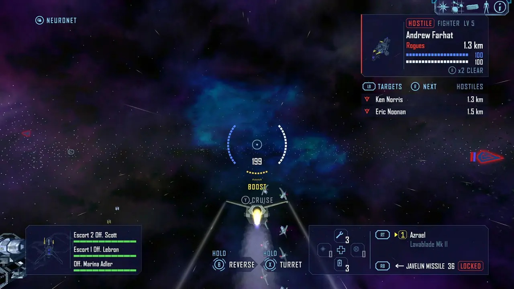

<sub>HUD 2, FLvibed's own flight HUD, in a fight on the controller (every picture here is a real in-game capture)</sub>

</div>

> **Made with AI ("vibe coded").** The code, the tools and the documentation were written by an AI (Claude, by
> Anthropic) under the owner's direction and tested in game. It comes with no warranty.

## 🌟 See everything in the living spec

<div align="center">

<a href="https://claude.ai/artifact/4v4dXbB5GTVt1URowFtSvN">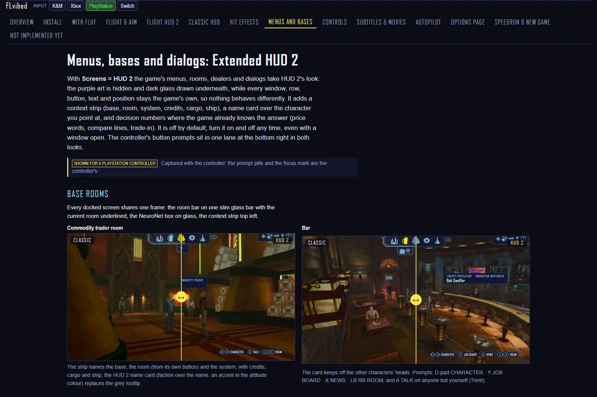</a>

<a href="https://claude.ai/artifact/4v4dXbB5GTVt1URowFtSvN"></a>

</div>

The best tour of FLvibed is its **living spec**: one interactive page with every feature, real in-game captures with
**drag sliders** (the game's HUD vs HUD 2, before vs after), an **Input switch** that shows the page as an Xbox,
PlayStation, Switch or keyboard-and-mouse player sees it, a **try-it-yourself options page**, the bindings diagram, the
install steps and an honest **"Not implemented yet"** list. It is kept current with every change.

📁 Offline copy in this repository: [docs/spec/index.html](docs/spec/index.html) - open it in a browser after cloning (it
needs no network).

## ✨ What you get

- 🎮 **Controller play everywhere.** Fly, fight, dock, trade and use every menu with an Xbox (XInput) pad: button
  prompts on each screen, glyphs for Xbox, PlayStation or Nintendo pads, an on-screen keyboard, three flight layouts
  (FREELANCER, ACE, ASSISTED). Touch the pad and the controller interface appears in one frame; move the mouse and the
  game's own interface is back. Keyboard and mouse keep working exactly as before.
- 🎯 **Gimbal aim.** The right stick steers through the game's own mouse flight; the reticle locks onto your target's
  lead by itself (or follows the stick, with aim assists). The ship is never steered for you.
- 🛰️ **HUD 2.** An optional flight HUD of FLvibed's own, in Freelancer's art: shield, hull and power on a ring around
  the reticle, only the actions that apply now. On by default with the pad; keyboard and mouse players can opt in. The
  classic HUD stays available, with glyph badges on its buttons and a short list of what you can do now.
- 💬 **Dialogue subtitles.** Story scenes, mission comms, bars and the Neural Net, with the speaker's name in their
  colour and their portrait, timed on the speaker's words. Story lines stay on screen until they are spoken; radio
  chatter and lines from NPCs without a portrait go to the game's chat window.
- 🎬 **Better movies.** The startup movies fit the screen with their aspect kept, and the intros (HD, original 2003,
  full Bonus DVD cut) are subtitled.
- ⚙️ **An options page in the game.** Every setting on a **FLVIBED** page inside the game's own Options screen: five
  tabs, changes apply at once, works with mouse, keyboard and pad.
- 🏁 **New Game modes.** Normal, Assisted (the autopilot ready from the first mission) or Speedrun mode (an in-game
  timer, a split per story checkpoint, LiveSplit fed automatically).
- 🤖 **The Advanced Autopilot** 🧪 *(work in progress).* Hand it the ship and it plays: missions, jobs, travel,
  docking and fights, by one set of rules - [all about it below](#-the-advanced-autopilot).
- 🖼️ **Extended HUD 2** 🧪 *(optional, off by default).* HUD 2's look over the menus, bases, dealers and dialogs.
  Every window, row and button stays the game's own.
- 💥 **Hit effects** *(optional, off by default).* Screen-edge cues in your own shield's and hull's look when you are
  hit, and reticle pulses for the autopilot and consumables.
- 🖥️ **Any screen.** Any resolution, aspect ratio and Windows DPI scaling; Borderless Windowed is the main mode.
- 🪶 **One file, nothing else.** `FLvibed.dll` with a static C runtime: no loader, no launcher, no Visual C++
  redistributable. Each part (controller, subtitles) can be switched off on its own, and no game file is changed.

## 📸 A look around

<table>
<tr>
<td width="50%">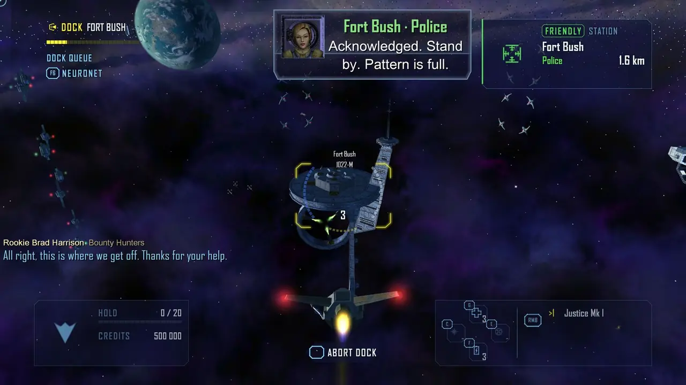<br><sub>💬 <b>Subtitles:</b> a comm with its portrait in the top panel, radio chatter in the chat window</sub></td>
<td width="50%">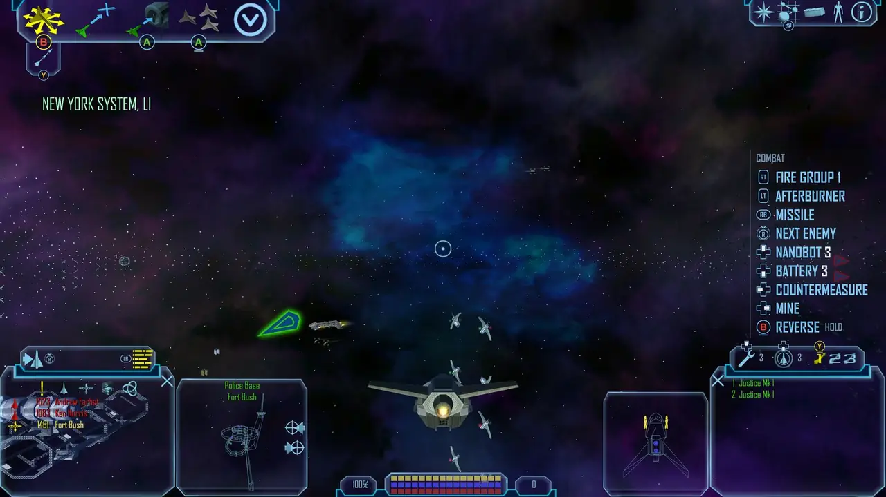<br><sub>🎮 <b>Classic HUD on the pad:</b> glyph badges on the game's own buttons, the actions that apply now</sub></td>
</tr>
<tr>
<td width="50%">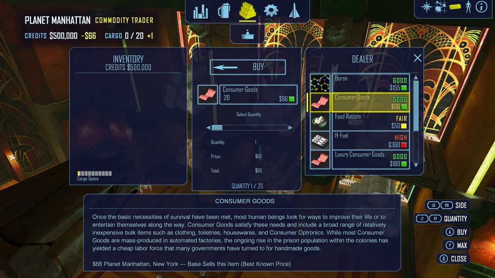<br><sub>🖼️ <b>Extended HUD 2:</b> a dealer in HUD 2's look, driven by the pad</sub></td>
<td width="50%">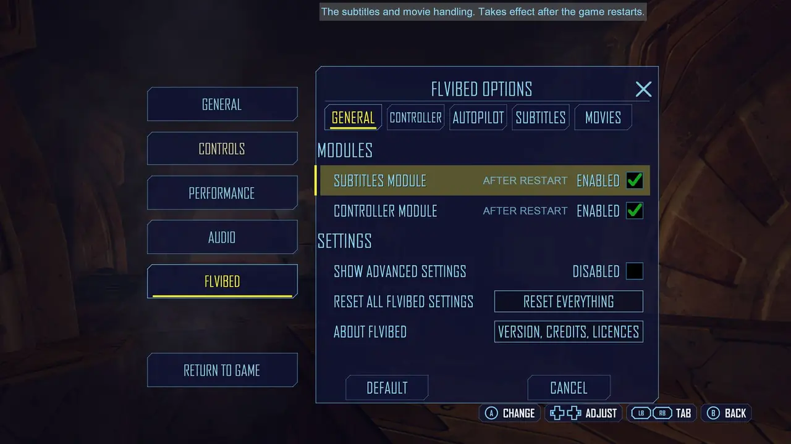<br><sub>⚙️ <b>The options page:</b> inside the game's own Options screen</sub></td>
</tr>
</table>

<div align="center">
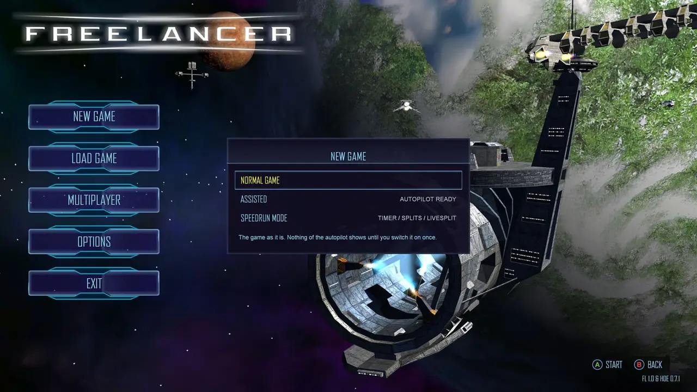<br>
<sub>🏁 <b>New Game:</b> normal, assisted or speedrun mode</sub>
</div>

## 🤖 The Advanced Autopilot

Hand FLvibed the ship and it plays Freelancer for you. One start for every device: **hold View** on the pad, or press
**K** (or the maneuver bar's autopilot button) on the keyboard. It picks what makes sense - the current mission or job
objective, else your nav map waypoints (across systems), else your target. Touch a stick, or press it again, and the
ship is yours.

<table>
<tr>
<td width="50%">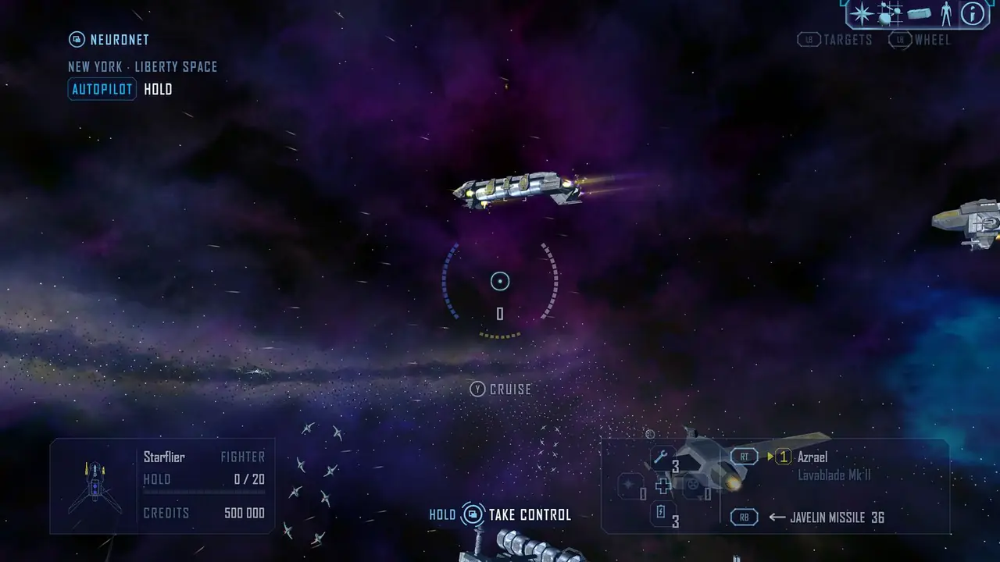<br><sub>🛰️ <b>Flying:</b> what it does on the HUD, one button to take control</sub></td>
<td width="50%">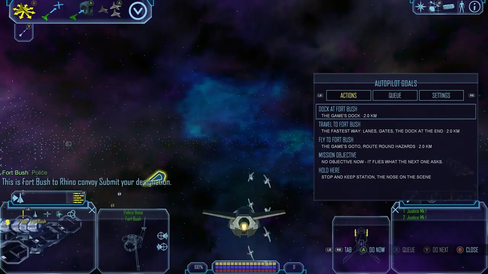<br><sub>🧭 <b>The goal panel:</b> tell it what to do (X on the pad, Shift+K on the keyboard)</sub></td>
</tr>
<tr>
<td width="50%">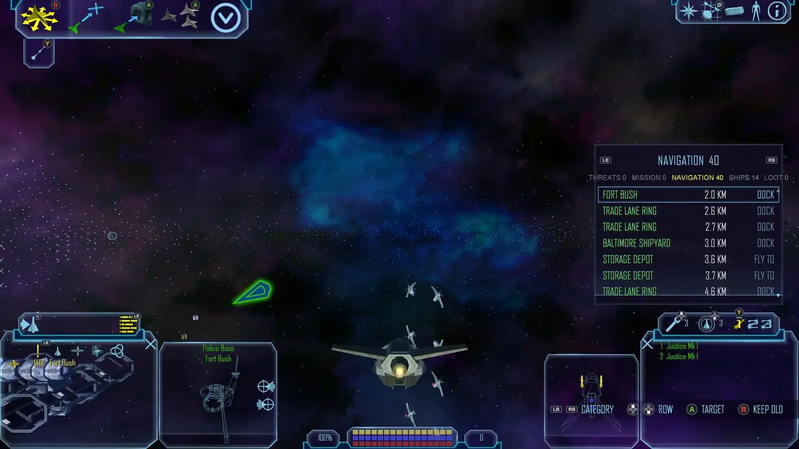<br><sub>🎯 <b>The target picker</b> (LB): threats, mission, navigation, ships, loot</sub></td>
<td width="50%">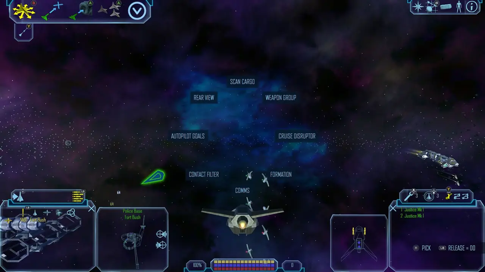<br><sub>🎡 <b>The action wheel</b> (LB held): quick actions on the right stick</sub></td>
</tr>
</table>

**What it does today**

- 📜 **Story missions** - it reads the mission's own objectives and trigger conditions live (no per-mission scripts)
  and has flown every story mission from the first to the last.
- 💼 **Jobs** from the job board, by the same objective reading (kill ships and assassinate jobs
  are proven so far).
- 🛣️ **Travel** by trade lanes, gates and jump holes, across systems along your waypoints, routing round minefields
  and damage zones.
- 🛬 **Docking** with the fast dock and the queue shortcut, skipping the docking scene.
- ⚔️ **Fights** - targets by threat and odds, evades, spends missiles by economy; escorts, follows, or holds station
  with its nose on the scene.
- 🛡️ **Reflexes under every goal** - countermeasures against homing missiles, nanobots and shield batteries by need,
  loot worth the detour.
- 💬 **It explains itself** - the HUD names what it does and why; a cyan ring marks it taking over, an amber one handing
  back.
- 🎛️ **Presets** - COMPETENT (the default: it knows only what you have seen), SPEEDRUN (it knows everything the game
  data tells) and NO CONSUMABLES; every behaviour also has its own setting.
- 🧑‍🚀 **It plays as you** - it starts from your live state (ship, reputation, the choices you made), never from a fixed
  script.

**How good is it?** Its yardstick is the fastest recorded human speedruns. Across all 14 story legs it is about 28 %
slower than the record pace today (12,867 s against 10,047 s), and within 6 seconds of it in mission 12. It still
fails some runs: docking at moving ships, the mines in mission 11 (about half its runs), deaths in missions 12 and 13.

**Where it's headed**

- 🏆 **Speedrun-grade play** - every story leg at or under the fastest human run, by one general set of rules.
- 🎬 **Zero input** - a New Game played through to the end of the story, unattended.
- 📋 **A goal queue** - queue, reorder and "do next": multi-step trips and trade runs as your own plan.
- 🤝 **Playing alongside you** - you on the guns or picking targets while it flies (the ASSISTED layout); how the two
  of you share control is still being designed.
- 🎚️ **Behaviour you mix and match** - focus (story, trading, jobs, exploring), engagement (fight, defend, avoid),
  routes (official lanes only, or shortcuts) and knowledge (what you have seen, or everything).
- 🖱️ **Everything on every device** - the target picker and the action wheel get keyboard-and-mouse versions.

## 🗺️ Where FLvibed is headed

| | Today | Headed for |
|---|---|---|
| 🎮 **Controller** | Every screen on the pad, three layouts, glyphs for three pad families; flight and combat proven on a real Elite pad | A bindings editor for your own layout, nav map objects as pad controls, every screen proven on real pads |
| 🛰️ **HUD 2** | FLvibed's own flight HUD; Extended HUD 2 over menus and bases as an option | Refined from real play; Extended HUD 2 kept or reworked from feedback |
| 💬 **Subtitles** | Every spoken line, timed on the words, with names, colours and portraits | Every line reviewed by ear against the audio |
| 🤖 **Autopilot** | Plays missions, jobs, travel, docking and fights | Speedrun-grade, zero-input, alongside you (above) |
| 🖥️ **Display** | Borderless windowed and windowed at any size and DPI | Exclusive fullscreen verified too |
| 📦 **Install** | A one-click installer and uninstaller (or the zip by hand) | TBD |
| 🧩 **Compatibility** | HD Edition 0.7.1, the original 1.1, FLUF beside it | Newer HD Edition releases, more mods |

> [!IMPORTANT]
> 🧪 **0.1.0 is an early preview - expect rough edges and change.**
> - **Some features are incomplete:** the Advanced Autopilot is work in progress, a few screens and controls are not
>   built yet, and some are proven only by the test harness so far.
> - **Design choices are still subject to change:** button layouts, HUD 2's and Extended HUD 2's look, setting names
>   and defaults, and how the autopilot behaves may all change in later versions.
>
> What is missing right now: [Known limits](#-known-limits).

## 📋 Requirements

- 🪟 **Windows 10 or 11.**
- 🚀 **Freelancer: HD Edition 0.7.1** - the base FLvibed is built and tested on. It brings everything else needed.
- 💿 Or **the original Freelancer 1.1 with a decrypted `Freelancer.exe`** (the CD's exe is SafeDisc-protected, and
  SafeDisc does not run on Windows 10 / 11). Verified in game through the first mission and a full regression pass.
- 🎮 **An XInput controller** (any Xbox pad) - or none: keyboard and mouse work too. FLvibed reads pads through XInput
  only: a PlayStation, Nintendo or other pad works when a layer such as Steam Input or DS4Windows presents it as an
  Xbox pad (the button prompts then follow the real pad's family, or pick it in `glyph_style`).
- You supply your own copy of the game. FLvibed ships no game files and no audio.

## 🚀 Getting started

**1. Prepare the game**

- **HD Edition:** install Freelancer: HD Edition 0.7.1 with its installer.
- **Original game:** install Freelancer with its official installer (it installs the fonts and registry keys), apply
  the official 1.1 patch and put a decrypted 1.1 `Freelancer.exe` into `EXE\`.

**2. Install FLvibed** - one click

1. ⬇️ Download **[FLvibed-0.1.0-Setup.exe](../../releases/latest/download/FLvibed-0.1.0-Setup.exe)** and run it.
   Windows SmartScreen may warn, because the setup isn't code-signed: choose *More info > Run anyway*.
2. It finds your game (HD Edition's installer, the original game's, or the usual folders - else you pick the folder):
   choose **Install or update FLvibed**. No administrator rights are needed unless the game folder is protected.

The setup copies FLvibed's files into `EXE\`, adds the line `FLvibed.dll` to `EXE\dacom.ini` and keeps your settings
on an update. No game file is changed.

<details>
<summary>🔧 Install by hand instead (the zip)</summary>

1. Download **[FLvibed-0.1.0.zip](../../releases/latest/download/FLvibed-0.1.0.zip)** and unpack it.
2. Copy its `EXE` folder into your Freelancer folder (the one that holds `EXE\Freelancer.exe`) and let it merge:
   `FLvibed.dll`, `FLvibed.ini`, `FLSubtitles\` and `FLvibed\` land in `EXE\`.
3. Open `EXE\dacom.ini` in a text editor and add the line `FLvibed.dll` to the `[Libraries]` section, after the plugins
   already listed (on the original game after `.\flmaterials.dll`).

To remove it by hand: take the `FLvibed.dll` line out of `EXE\dacom.ini`, then delete `EXE\FLvibed.dll`, `FLvibed.ini`,
`FLController.ini`, `FLSubtitles.ini`, the FLvibed logs and the folders `EXE\FLSubtitles\` and `EXE\FLvibed\`.

</details>

**3. Play.** Start the game as usual and pick up the pad. Settings: **Options > FLVIBED** (also the pause menu's sixth
button). `EXE\FLvibed.ini` switches each part on or off (`subtitles = 1`, `controller = 1`).

**🗑️ Uninstall:** *Windows Settings > Apps > Installed apps > FLvibed*, or run the setup again and choose **Uninstall
FLvibed**. It takes FLvibed's line out of `dacom.ini` and deletes its files; you choose whether your FLvibed settings go
too. Your saves are never touched (the per-save game mode lives in `EXE\FLvibed\saves.ini`, not in the save).

## 🎮 Controls

The default **FREELANCER** layout in flight:

| Button | Tap | Hold |
|---|---|---|
| Right stick | steer | |
| Left stick | throttle / strafe | |
| RT | fire guns | |
| LT | afterburner | |
| RB | missile | torpedo |
| LB | target picker | action wheel |
| A | context: dock / lane / jump, tractor loot, else go to | formation |
| B | free flight (drops cruise) | reverse |
| X | tractor (shown under the reticle while loot is in reach) | turret view on / off: the reticle stays centred, the right stick turns the camera |
| Y | cruise (its state always under the reticle) | next weapon group |
| RS (click) | target ahead: the nearest object inside the reticle ring, again the next one; nothing there: closest / next enemy (double click: clear) | rear view |
| LS (click) | engine kill | |
| D-pad | ⬆️ nanobots · ⬇️ shield battery · ⬅️ countermeasures · ➡️ mine | |
| View | NeuroNet / nav map | half a second: Advanced Autopilot |
| Menu | pause | |

- 🕹️ **Menus and bases:** A accept, B back (hold: back out entirely), LB / RB tabs, LT / RT pages, D-pad or left stick
  move the focus, a left-stick click switches to a free cursor, right stick scrolls, View the NeuroNet hub, Menu pause.
- ⌨️ **Keyboard and mouse:** the game's own keys. **K** (or the maneuver bar's fifth button) starts the autopilot - it
  picks the current mission or job objective, else your nav map waypoints, else your target; **Shift+K** opens its goal
  panel.
- ✋ Any stick input past a threshold hands the ship back from the autopilot. Prompts for held buttons say **HOLD**
  beside a broken-ring outline on the glyph.

The ACE and ASSISTED layouts and the per-screen controls: [docs/UI_PLAN.md](docs/UI_PLAN.md); the research behind the
layouts: [controller/docs/BINDINGS.md](controller/docs/BINDINGS.md).

## ⚙️ Settings

Change settings in game on the **FLVIBED** page of the Options screen. They are stored in the game's `EXE\` folder
(`FLvibed.ini` `[Modules]`, `FLController.ini` `[Controller]` + `[Autopilot]`, `FLSubtitles.ini` `[Subtitles]`). The
ones most players touch:

| Setting | Default | What it does |
|---|---|---|
| `pad_preset` | 0 | flight layout: 0 Freelancer, 1 Ace (left stick steers, triggers throttle), 2 Assisted |
| `aim_mode` | 1 | 1 gimbal (reticle locks onto the target's lead), 0 the reticle follows the right stick |
| `hud_style` | 1 | 0 classic HUD, 1 HUD 2 on the pad, 2 HUD 2 always |
| `ui_style` | 0 | menus and rooms: 0 the game's look, 1 HUD 2's look (Extended HUD 2) |
| `glyph_style` | 0 | button prompts: 0 automatic, 1 Xbox, 2 PlayStation, 3 Nintendo |
| `input_mode` | 0 | 0 automatic (the last device used wins), 1 controller, 2 keyboard and mouse |
| `autopilot_pad` | 0 | autopilot on the pad: 0 hold View, 1 both stick clicks, 2 hold Menu |
| `shield_cue` | 0 | hit effects at the screen edges |
| `borderless` | 1 | 0 off, 1 only where nothing else provides it (HD Edition does), 2 always |
| `enabled` (Subtitles) | 1 | subtitles on |
| `size` (Subtitles) | 1 | text size, 0 small to 4 huge |
| `speaker_names` | 0 | 0 the name on its own row, 1 inline, 2 off |
| `movie_fit` | 1 | movies keep their aspect, encoded black bars zoomed out |
| `movie_intro` | 0 | which intro plays: as installed, HD, original 2003, full Bonus DVD |

📖 Every key with type, range, default and help (generated from the code): [docs/SETTINGS.md](docs/SETTINGS.md).

## 🧩 Compatibility

| With | State |
|---|---|
| ✅ **Freelancer: HD Edition 0.7.1** | The primary target: every feature is built and tested on it (4K borderless and 1600x1200 windowed among others). Its plugins (jflp, FLSharp 0.8, HudShift, flplusplus ...) run alongside; FLvibed's hooks chain behind theirs. The newer HDE after 0.7.1 is checked by reading its exe and patches only, not in game yet. |
| ✅ **The original Freelancer 1.1** (decrypted exe) | Runs the whole mod; verified in game through the first mission and in a regression pass (flight, both HUDs, a base and a dealer, comms with subtitles, the autopilot). Without HDE's plugins: no zone arrival lines in HUD 2 and no maneuver-bar shift. |
| 🧪 **FLUF** (The Starport's framework) | Tested with FLUF nightly-2026-10-16 on the original game: FLUF's windows stay on top, FLvibed's HUD fades under them, the pad drives them. That FLUF build has its own issues (details in [docs/MOD_COMPATIBILITY.md](docs/MOD_COMPATIBILITY.md)); other FLUF builds get co-residency only. FLUF does not load on HD Edition. |
| 🧪 **Borderless windowed** | HD Edition provides it and FLvibed stays out. On the original game FLvibed runs the game as a borderless window covering its monitor - sharp at high DPI scaling only with a DPI-aware exe. In any borderless window that covers its monitor the mouse stays in the game at the screen edges, as in fullscreen. |
| ❔ **Exclusive fullscreen** | Not verified - use borderless or windowed. |
| ❔ **Other mods** (Discovery, Crossfire ...) | Not tested. Every game address FLvibed uses is verified by signature, so a spot another mod changed is refused (and logged) instead of crashing. |

## 🚧 Known limits

What 0.1.0 does not do yet, or does only in part. Anything here - and the design around it - may still change.

- 📦 **Unsigned setup:** Windows SmartScreen may warn before the setup runs (*More info > Run anyway*).
- 🎮 **XInput only:** no DirectInput or native PlayStation / Nintendo support; those pads need an XInput layer (Steam
  Input, DS4Windows ...).
- 🤖 **The Advanced Autopilot is work in progress:** it still fails some runs, its goal queue (QUEUE / DO NEXT) is
  not built, and how it shares control with a player on the guns is not designed yet ([details](#-the-advanced-autopilot)).
- 🎮 **Real pads:** flight and combat are verified on a real Xbox Elite pad; the menus, bases, dealers and on-screen
  keyboard so far on a virtual pad only.
- 🖱️ **Pad-only pieces:** the target picker and the action wheel have no mouse version yet (keyboard and mouse target
  through the game's contact list).
- 🧱 **Not built yet:** a bindings editor (the three layouts apply; CUSTOM = FREELANCER), nav map objects as pad
  controls, the inventory's jettison hold and the equipment compare line.
- 🖥️ **Exclusive fullscreen** is not verified, nor the movie subtitle overlay in it. OBS Game Capture cannot see the
  movies or their subtitles (use Window or Display Capture).
- 💬 **Subtitle text:** speech-to-text checked against transcripts; the line-by-line review is still in progress, so a
  few lines may differ slightly from what is spoken.
- 🧪 **Beside FLUF**, and **FLvibed's borderless window** by a player (Alt+Tab, Alt+Enter, the cursor at the screen
  edges): verified by the test harness only so far.

The full, current list is the [living spec](https://claude.ai/artifact/4v4dXbB5GTVt1URowFtSvN)'s "Not implemented
yet" section.

## 📚 More

- 🌟 [The living spec](https://claude.ai/artifact/4v4dXbB5GTVt1URowFtSvN) (offline copy: [docs/spec/](docs/spec/index.html))
- ⚙️ [All settings](docs/SETTINGS.md) · 🧩 [Mod compatibility](docs/MOD_COMPATIBILITY.md) ·
  🤖 [The autopilot](controller/docs/AUTOPILOT.md) · 💬 [Subtitle display](subtitles/docs/DISPLAY_PLAN.md) ·
  🎨 [UI decisions](docs/UI_PLAN.md), [HUD 2](docs/UI_HUD2.md)
- 🧠 [Verified game facts](docs/FREELANCER_RE.md) and the [game knowledge base](docs/kb/README.md)

## 🛠️ Building from source

Needs Visual Studio with the C++ desktop tools (the latest installed one is used); `build.cmd` finds it and builds
32-bit (x86), C++17, with the static C runtime.

```bat
build.cmd release   :: build\release\FLvibed.dll - everything in one DLL (what players get)
build.cmd           :: dev build: build\dev\FLvibed.dll (hooks) + FLControllerImpl.dll / FLSubtitlesImpl.dll (logic, hot-reloadable)
build.cmd test      :: build\test\fltest.exe - host-free unit tests, built and run in seconds, no game needed
build.cmd sigtool   :: build\sigtool\sigtool.exe - the Freelancer.exe signature tool
build.cmd setup     :: build\setup\FLvibed-Setup.exe - the players' installer / uninstaller (after build.cmd release)
```

`tools/deploy.ps1` builds, installs into a test install and starts or hot-reloads the game. The development tools
(PowerShell, Python, Node) and the test rules: [tools/README.md](tools/README.md), [docs/TESTING.md](docs/TESTING.md).

<details>
<summary>🗂️ Project layout</summary>

| Path | What |
|---|---|
| `core/` | DLL entry and module switches, hooks (signature-verified game addresses in `core/flexe.h`), settings, logging, the shared game layer (`core/game/`: rooms, missions, space, routes, flight, drawing in the game's look) |
| `controller/` | The controller module: pad input, layouts, HUD 2, the pad UI, the Advanced Autopilot; its test harness in `controller/tools/`; docs in `controller/docs/` |
| `subtitles/` | The subtitles and movies module: hooks, display, shipped data in `subtitles/data/`; docs in `subtitles/docs/` |
| `subtitles/review/` | The subtitle text's authoring: speech-to-text pipeline, word aligner, review tool and every review decision; it publishes the data into `subtitles/data/` ([its process](subtitles/review/docs/REVIEW_PROCESS.md)) |
| `docs/` | Design and reference: the UI, settings, compatibility, testing, verified game facts, speedrun splits, the spec (`docs/spec/`) |
| `docs/kb/` | The game knowledge base: topic pages, mission set pieces, lore |
| `docs/missions/` | Mission runbooks for the test harness |
| `docs/research/` | Outside research (other mods, speedruns, UI references), kept current |
| `research/` | Local evidence and reference material, git-ignored except the speedrun legs table |
| `tools/` | Build, deploy, test, evidence and game-data tools; the spec's source in `tools/uimock/` |
| `tests/` | Host-free unit tests of the pure core pieces (`build.cmd test`) |

</details>

## 📜 Credits and licences

**Freelancer** is © Microsoft. FLvibed uses game content under the Microsoft Game Content Usage Rules
(https://www.xbox.com/en-US/developers/rules). It is free and non-commercial, and it is not endorsed by or affiliated
with Microsoft. Players supply their own game; this repository and FLvibed ship no game files and no audio. The
pictures in this README and in `docs/spec/` are captures of the game with FLvibed running.

**Subtitle data** (`subtitles/data/`): the spoken lines and speaker names only, in separate data files. It uses the work
of **FLSubs** by Lorash, **Freelancer Subtitles** by L@Zar0 and the Russian edition's editor (GPL-3.0), and the
**wedge009.net** mission transcripts (CC BY-SA 4.0) and the other transcript sites they cite. The subtitle data is
therefore licensed **GPL-3.0** ([LICENSES/GPL-3.0.txt](LICENSES/GPL-3.0.txt)), with thanks to everyone who contributed.

**Code licence:** not decided yet by the owner. Until it is, no licence is granted for the code.

🙏 **Thanks** to Jason Hood (adoxa) for his Freelancer plugins and their sources, the Freelancer: HD Edition team, The
Starport (FLUF, FLSubs) and the Freelancer community's documentation and transcripts.
